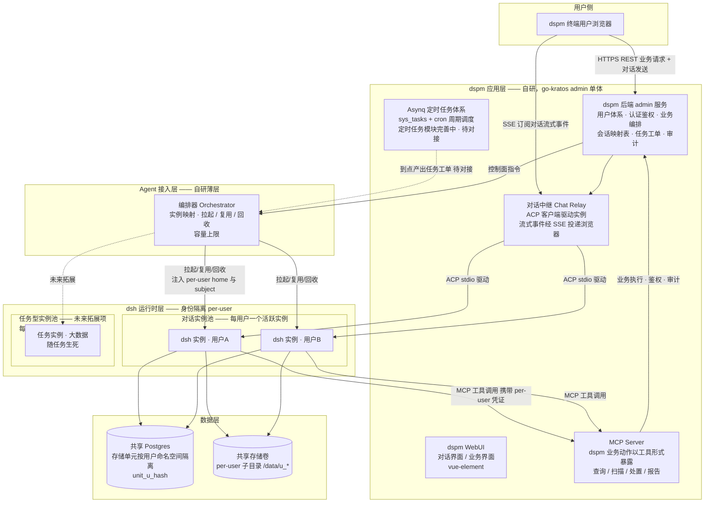
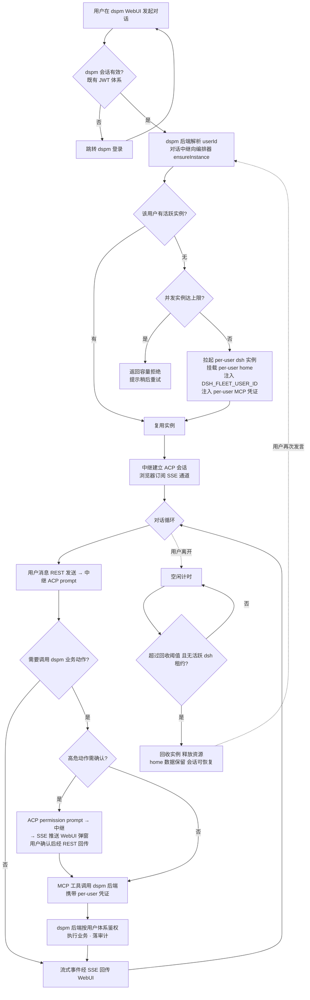
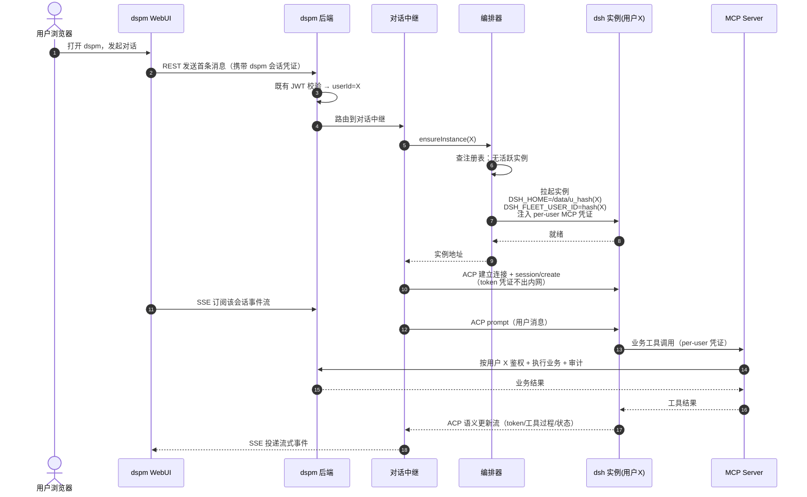
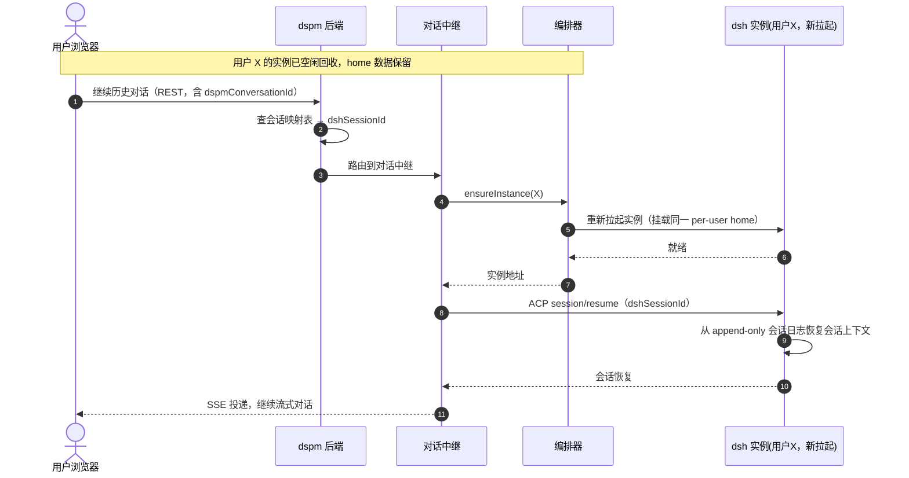
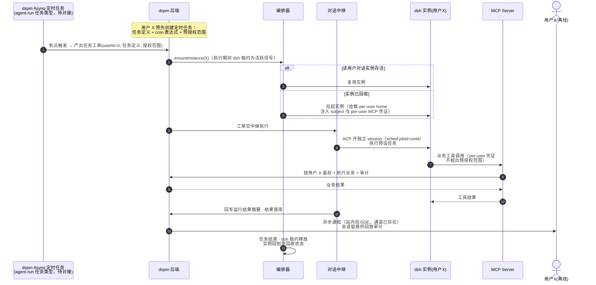
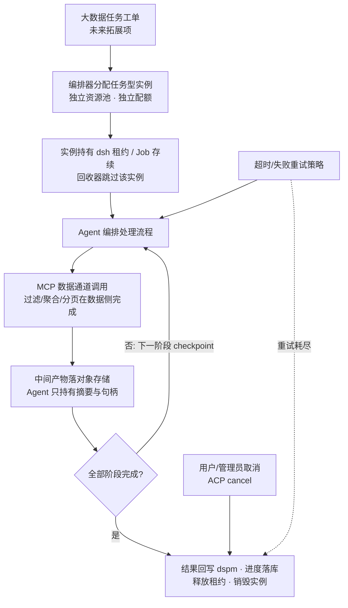

# DSPM 智能体平台总体设计——基于 DeepSeek Harness（dsh）的多用户 Agent 底座

| 项 | 内容 |
|---|---|
| 文档状态 | 草案 v0.6（待评审） |
| 日期 | 2026-10-20（v0.1 于 2026-10-14，v0.2 于 2026-10-15，v0.3 于 2026-10-19，v0.4/v0.5 于 2026-10-20） |
| 读者 | dspm 平台架构组、后端组、前端组、SRE |
| 约束 | dsh 侧论断以 `openlogos/align-core-specs` 分支（@ 9d820bd0f8，领先 master 48 提交，自维护）为准，出处见附录 A；dspm 侧论断以 dspm 仓库现状为准，出处见附录 C |
| 变更记录 | v0.6.1：阶段 1 前置 Spike 结论并入（2026-10-20，报告 `docs/preview/dsh-stage1-spike-mcp-resume.md`）——MCP-over-HTTP 工具调用链路实测通过（ACP session/new 挂 streamable-http MCP、agent 自主调多工具、纯 JSON 响应即可）；session/resume 跨进程实测：agent 上下文连续、client 侧零重放，§5.6 接受代价与 dsh 侧立项交付物（补帧语义）同步修订。v0.6：**决策六定案（2026-10-20 人类决策）——选定 (c) ACP-over-network**：dsh 侧立项网络形态 ACP（传输 + 安全模型），阶段 2 前置由"通道选型"改为"(c) 交付"；§5.6 改写为已定决策含三候选存档与选定理由；§5.2/§7.2/§3.4/§6.2/§12/风险 #11 同步。v0.5：架构约束钉死——dspm 后端为共享多副本服务、dsh 实例 per-user pod，relay 与实例不可能同 pod，**stdio ACP 仅为 spike/本地形态、不是终态候选**（§5.2/§5.6/§3.4 修订）；决策六候选 (b) 补 M3 核实语义（队列认领 + durable inbox 续跑 + relay cursor 订阅，runner 挂 lease+dispatch、Web/API 副本挂 relay subscription；schema 为 pre-release 版本戳）。v0.4：按 dsh 分支 M1–M4 与 cluster-web 已交付事实重核——§3.3 fleet 评价、§3.5 调度边界、§6.4 编排器职责、§7.3 恢复模型修订；新增 §3.7（分支已交付能力与「逻辑实例 vs pod」澄清）与 §5.6 决策六（relay→运行时驱动通道，开放待选型）；决策五论证重写（dsh M4 已具备分布式调度，结论保留、理由变更）；阶段 0 标记完成并补实测数据；风险表 #2/#3/#5 更新、新增 #11/#12；附录 A 复核基线改为分支、附录 C 补 spike 现状。v0.3：对照 dspm/dsh 两仓库现状评审调整——决策二改为方案 B（ACP 驱动 + SSE 中继），取消独立认证网关；调度器复用 dspm 已有 Asynq 体系，定时任务线标记「等待 dspm 定时任务模块对接」；大数据处理与多租户隔离降级为未来拓展项；明确 dsh 为自维护代码 + 定期合并上游 bugfix 的定位。v0.2：新增第 8 章"扩展场景：定时任务与大数据处理"；架构图补充调度器与任务型实例池；新增决策五；容量模型与 Roadmap 相应更新 |

---

## 1. 背景与目标

企业正在建设 DSPM 上层应用（下称 dspm），其产品形态为：**终端用户通过自研 WebUI 与 AI 对话，以对话方式发起和驱动业务**（参考 Flocks / OneSOC 类交互式安全运营产品）。dspm 自持完整用户体系（注册、认证、鉴权、组织/角色，现状见附录 C），需要一个 AI 服务底座向其提供多 Agent 能力，并保证**不同 dspm 用户之间的会话与数据严格隔离**。

选型结论：以 Agent 运行时 **DeepSeek Harness（dsh）为底座**，不在 dsh 内部实现多用户，而是将 dsh 作为**每用户/每任务的隔离运行时**，由 dspm 侧新建薄控制平面完成用户到运行时的映射与生命周期管理。dsh 代码为**自维护**（内部仓库托管），定期合并上游 bugfix；base 版本锁定、升级走评审（见 §3.6）。

### 1.1 目标

- dspm 终端用户通过 dspm WebUI 对话式使用 Agent 能力，全程不感知 dsh 的存在。
- 多用户数据隔离：会话、工作区文件、存储数据按 dspm 用户隔离（**本期为固定单租户下的 per-user 隔离；多租户维度为未来拓展项**，见 §9）。
- 流式体验：AI 输出低延迟流式到达浏览器（复用 dspm 现有 SSE 通道，见 §5.2）。
- 业务闭环：Agent 可调用 dspm 业务动作（查询、扫描、处置等），高危动作支持用户确认。
- **无人值守触发**（本期标记「等待对接」）：用户可设置定时任务，到点自动调用 Agent 执行业务，结果异步交付。**依赖 dspm 定时任务模块完善后对接**，见 §8.2。
- **大数据处理**（未来拓展项）：Agent 可编排大数据量级的业务处理，与对话负载资源隔离，见 §8.3。
- 弹性成本：运行时资源占用与**并发活跃工作负载**挂钩，而非注册用户数。

### 1.2 非目标

- 不改造 dsh 内核为"单进程多租户"。dsh 的身份、存储、凭据均为进程级单用户假设（见 §3），请求级多租户改造等于重写，不在本方案范围。
- 不在 dspm 内复用 dsh 自带的 Web UI 及其 token 认证体系。
- 不直接采用 dsh 仓库的 `fleet`（fleet-manager / gateway）组件做生产部署——其为 alpha 级库组件且为单机模型，仅作设计参考（见 §3.3）。
- **不以 dsh 内置 `schedule` / `jobs` 包充当平台级调度与长任务机制**——调度循环与任务状态均绑定 Host 进程存续，实例回收后即失效（见 §3.5）。
- **不新建独立认证网关，本期不启用 APISIX**——决策二采纳方案 B 后，浏览器流量全部经 dspm 后端，不存在浏览器直连实例的通道（见 §5.2、§6.3）。
- **本期不做多租户隔离设计**——dspm 当前租户固定，仅要求对接 dspm 用户体系；租户维度隔离标记为未来拓展项（见 §9）。
- **本期不交付大数据处理**——依赖数据平台（数仓/查询引擎）建设，标记为未来拓展项（见 §8.3）。
- dspm 自身业务域设计（数据模型、检测规则、报表等）不在本文范围。

---

## 2. 术语

| 术语 | 含义 |
|---|---|
| dsh | DeepSeek Harness，Agent 运行时（本仓库，自维护 + 定期合并上游 bugfix） |
| Harness home / `$DSH_HOME` | dsh 实例的私有数据目录（会话日志、凭据、存储等） |
| dspm | 上层业务应用（自研，go-kratos 单体 admin 服务 + vue-element 前端），持有用户体系 |
| 对话中继（Chat Relay） | dspm 后端新增模块：以 ACP 客户端驱动用户实例，将流式事件经 SSE 投递到浏览器 |
| 编排器（Orchestrator） | 自研薄控制平面，负责 dsh 实例的拉起、复用、回收与容量上限（防误回收依托 dsh 租约，v0.4） |
| 调度器 | dspm 后端已有的 **Asynq 定时任务体系**（`sys_tasks` 任务表 + cron 周期调度），到点产出任务工单；**本期定时任务模块完善中，待对接** |
| 任务工单（Task Ticket） | 统一的任务描述：谁、做什么、触发条件、授权范围、结果去向 |
| 任务租约（Lease） | **v0.4 起编排器侧概念退役**：对话/定时任务负载的防误回收归 dsh `session-lease`（runner 持约即活跃信号，§6.4）；未来任务型实例池按 K8s Job 存续管理（§8.3） |
| MCP | Model Context Protocol，dspm 以 MCP server 形式向 Agent 暴露业务动作 |
| ACP | Agent Client Protocol，dsh 提供的程序化 Agent 管理协议（`packages/acp`） |
| SDK | dsh 的 JSON-RPC 编程接口（`packages/sdk`，TS 与 Python 双实现） |
| SSE | Server-Sent Events，dspm 已有的推送通道（独立端口 :7789 + 前端 sse_client） |

---

## 3. dsh 现状与关键仓库事实

本节论断 v0.3 经 2026-10-19 对照仓库逐条复核；v0.4（2026-10-20）按 `openlogos/align-core-specs` 分支（@ 9d820bd0f8，领先 master 48 提交）重核，M1–M4 已交付能力见 §3.7，§3.3/§3.5 结论相应修订。出处见附录 A。

### 3.1 dsh 是单用户运行时

- dsh web 的访问凭证为**启动时打印的带 `?token=` 的 URL**，换取签名 cookie 后访问；官方文档明确该 URL 是"进程凭证"，只能分享给预期用户。系统内部无用户概念。
- `identity` 包仅提供**匿名安装 ID**（用于遥测归因），不是用户身份体系。
- 会话存储中**无 `user_id` / 租户维度字段**（对 `packages/session/` 全量 grep 核实为零命中）；一个进程的所有请求共享同一身份与同一 `$DSH_HOME`。
- 当前 K8s 验证部署（`docker-desktop` / `dsh-cluster-web-staging`）为前后端分离形态（`dsh-frontend` 1 副本、`dsh-api` 2 副本共享同一 `$DSH_HOME` PVC、`dsh-postgres` 1 副本），该形态解决的是**可用性与负载**，不构成多用户隔离——所有访问者看到同一批数据。

### 3.2 现成的隔离支点（可复用资产）

1. **存储命名空间 seam**：`packages/storage/storage-domain/src/namespace.ts` 实现——进程启动时注入环境变量 **`DSH_FLEET_USER_ID`** 后，所有存储单元按 `<unit>_u<16hex>` 派生命名（sha256(subject) 前 16 hex），并保留 `/_u[0-9a-f]{16}$/` 后缀形状防止用户撞名。多用户可安全共享同一存储介质（如同一 Postgres）而互不可见。**该机制是环境变量注入，不绑定任何特定编排器**，任何拉起 dsh 进程的控制平面均可使用。
2. **显式 Harness home**：Python SDK 文档明确"每次启动必须显式选择 Harness home，绝不静默读取 `~/.dsh`"——per-user 独立 home 是原生支持的启动方式。
3. **会话持久化**：会话日志为 append-only 代际格式，进程回收后数据保留，同 home 重新拉起即可恢复会话（fleet-manager README 已验证此语义）。

### 3.3 fleet 组件：M1 起为 dsh 侧正式演进部件（v0.4 修订标题）

`packages/fleet`（fleet-manager + gateway，版本 `0.2.1-alpha.1`）实现了完整的"每用户一进程一 home + OIDC 网关路由"模型，测试覆盖充分，但：

- 全仓库**无任何部署入口**引用这两个库（`apps/`、`deploy/` 零引用，2026-10-19 grep 核实），需自写入口进程；
- 明确声明**单机限制**（进程内注册表，多机 fleet 是后续里程碑）、Windows 未测、极简 OIDC 客户端（无 JWKS 验签、无 refresh token）；
- 与 K8s 副本模型不同构。

**结论（v0.4 修订）**：fleet 的设计决策（惰性 provisioning、空闲回收保数据、重启预算、subject 绑定路由、内部凭证不出内网）仍作为本方案编排器的设计蓝本。v0.3 的"组件本身不进生产"判定需修正——dsh 分支 M1（`user-fleet-gateway`，2026-10-07 归档）已为 fleet-manager 补 staging 部署编排与冒烟，fleet 从"仅参考"变为 dsh 侧演进中的正式部件；其"单机进程内注册表"限制仍在，但跨节点执行已由 M3 的 dispatch/lease 以共享 Postgres 为真相源另路解决（见 §3.7）。dspm 编排器与 fleet 的职责划界见 §6.4（v0.4 修订）。

### 3.4 程序化接入面（dspm 与 dsh 的连接方式）

| 接入面 | 形态 | 能力 | 本方案中的角色 |
|---|---|---|---|
| ACP server（`packages/acp`） | 标准 Agent Client Protocol over JSON-RPC **stdio（网络形态 ACP-over-network 决策六已立项，v0.6，§5.6）** | 会话 create/list/resume/close、**挂载 MCP server**、权限确认应答、取消、语义更新流 | **主要通道**：spike/本地为 stdio，pod 形态为 ACP-over-network |
| JSON-RPC SDK（`packages/sdk`） | TS / Python 客户端以 stdio 驱动 `dsh --profile sdk` 子进程 | 开会话、发 prompt、订阅会话事件与 subagent 完成通知 | 控制面对运行时实例的管理通道（可选补充） |
| Web API（`packages/api` BFF） | 浏览器 RPC，同源、host fence、host-only cookie | dsh web 前端使用的完整 API | **不使用**（方案 B 下浏览器不直连实例，见 §5.2） |
| headless profile | `dsh --profile headless "task"` | 一次性任务执行 | 批处理型业务（可选补充，未来拓展） |
| 执行池 PG 协议（v0.4 新增，M3 已交付） | 共享 Postgres 表 + listen/notify（`agent-dispatch` 队列、`session-lease`、`stream-relay`） | 会话派发、跨节点单写租约、非 owner 流订阅 | **决策六候选 (b) 的通道**（pod 形态，§5.6/§3.7） |

多 Agent 能力由 dsh 内置的 `subagent` / `preset` / `workflow` 包提供，dspm 无需自建 Agent 并行机制。

### 3.5 内置调度与后台任务原语的边界

dsh 仓库自带的两个相关包均不能充当平台级能力：

- **`schedule` 包**：**单 Host 进程内调度 + 持久化任务记录**——调度循环为 Host 进程持有的会话内提醒（一次性/固定频率/每日/每周/cron），到点以"普通 follow-up 消息"送达**原会话**，官方明确**不支持邮件、短信、推送**；任务记录经 storage-domain 持久化、Host 重启后可恢复，但**实例被空闲回收后 Host 不在，任务不会触发**。
- **`jobs` 包**：**进程内**后台任务机制——长任务注册为 job，发起的 Agent 可查询/等待/取消而不阻塞自身轮次，完成通知送达所属会话；存储为 process-local，**随进程生死**。

**结论（v0.4 修订）**：v0.3 的判定依据已被 dsh 分支 M4 改变——`schedule-dispatch` 以共享库到期行 + `FOR UPDATE SKIP LOCKED` 恰一取用 + 会话租约约束投递实现跨副本调度（重启后恢复由表行承载），`webhook-ingress` 入口已无状态化（见 §3.7）；"实例回收后任务不触发"不再成立。决策五的结论保留（产品级调度归 dspm/编排层，见 §8），但理由变更：任务的产品语义（预授权范围、结果通知、审计、与 `sys_tasks` 体系统一）归 dspm，dsh 调度为执行层原语、不承载产品语义；对接时评估复用边界（§8.2）。

### 3.6 风险基线

- dsh 公开 API 官方声明为 **pre-stable**。本方案中 dsh 为**自维护代码 + 定期合并上游 bugfix**：风险性质从"被动跟随上游"变为"自我演进的稳定性管理"——base 版本锁定、合并上游 bugfix 与自研改动均走评审；对 ACP 协议面可反向要求冻结或变更预审。
- 方案 B 下 dspm **不依赖 dsh BFF 浏览器线协议**（同为 pre-stable），外部协议面收敛为 ACP（server-to-server），pre-stable 暴露面减半（见 §5.2）。

### 3.7 dsh 分支已交付的多用户与集群能力（v0.4 新增）

基线：`openlogos/align-core-specs` @ 9d820bd0f8（领先 master 48 提交，自维护）。分支按 `logos/resources/reference/note/2026-10-06-multi-user-and-cluster-plan.md`「先隔离、后集群」路线推进，M0–M4 全部交付归档（`logos/changes/archive/`），另有 cluster-web 系列完成容器化与 K8s 部署基线：

| 里程碑 | 交付 | 对本方案的意义 |
|---|---|---|
| M1 user-fleet-gateway（10-07 归档） | fleet-manager per-user 进程注册表、staging 部署编排与冒烟 | 隔离边界 = 进程 + 目录；fleet 成为正式演进部件（§3.3 修订） |
| M2 shared-persistence-backends（10-08 归档） | 会话持久化 / KV（per-user 命名空间）/ attachment / spill 的**共享 Postgres 后端** | **会话不再绑定具体实例**：任意实例挂库即可恢复（§7.3 修订）；命名空间 seam 从"接口"变为"已交付后端" |
| M3 agent-runner-pool（10-08~09 归档） | `session-lease(-postgres)` 跨节点单写者（原子接管）、`stream-relay(-postgres)` 单调日志 + cursor 重放（非 owner 副本实时跟随）、`agent-dispatch` 队列 + runner 认领编排 | 跨节点执行池原语；会话单写一致、长任务接管、滚动升级排空下放 dsh（§6.4 修订） |
| M4 distributed-host-services（10-09 归档） | `schedule-dispatch`（共享库到期行恰一取用）、`webhook-ingress`（无状态入口）、`agent-dispatch.drain()` 按会话粒度滚动升级 | "实例回收后调度失效"不再成立（§3.5/§5.5 修订） |
| cluster-web 系列（S46/S47，10-09~10-16） | FE/BE 容器拆分、无状态 api 副本共享 `$DSH_HOME`、Helm chart、HTTP 探针、docker-desktop staging 验证通过 | pod 部署基线（附录 B）；单逻辑实例横向扩容形态 |

**关键澄清（逻辑实例 vs pod）**：cluster-web 的"一前端 ↔ 多 api pod"是**同一逻辑实例的横向扩容**——全部副本共享同一 `$DSH_HOME` 与同一身份，解决可用性与负载，不构成多用户隔离（§3.1 结论不变）。本方案的"每用户一个实例"指**隔离单元**（per-user home + subject + 存储命名空间），是逻辑实例；pod 只是其工作负载单元。二者正交：每个 dspm 用户一个逻辑实例（起步单 pod），实例内部如需高可用可演进为 cluster-web 式多副本——M3 的 lease/relay/dispatch 正是"一个逻辑实例跨多 pod"成立的基础设施。

---

## 4. 总体架构

### 4.1 架构图

### 4.2 架构要点

1. **对话中继承载流式路径**。对话数据走"浏览器 → dspm 后端（REST 发送 + SSE 订阅）→ 对话中继（ACP 客户端）→ 用户实例"。dspm 后端进入流式路径，换取：前端只面对 dspm 自有协议、不依赖 dsh pre-stable 的浏览器线协议、复用现有 SSE 基础设施（:7789 + sse_client）、与无人值守工单模型天然统一。多一跳的延迟代价为毫秒级，阶段 0 实测验证（§12）。中继→实例的 ACP stdio 连线为本地/同进程形态；pod 形态按决策六（§5.6）替换，图意与前端协议不变。
2. **无独立认证网关**。方案 B 下浏览器不直连实例，不存在需要透传与重写的浏览器通道；实例端口仅 dspm 后端与编排器可达（K8s NetworkPolicy），dsh 实例的 token 凭证不出内网。APISIX 本期不启用（dspm 虽有 forward-auth 集成先例，但动态 per-user 路由不在本期范围）。
3. **业务动作走 MCP 回流 dspm**。Agent 需要执行 dspm 业务时，调用实例上挂载的 MCP server（由 dspm 提供）。因为实例本身是 per-user 的，MCP 通道在实例拉起时注入**该用户范围的访问凭证**，授权天然收敛到当前用户。
4. **隔离边界 = 进程边界 + 命名空间 + per-user 目录**，不依赖应用代码"永不出错"。
5. **三类触发统一为任务工单**：交互式对话（浏览器经 dspm 后端）、定时任务（Asynq 到点产出工单，**待 dspm 定时任务模块完善后对接**）、大数据任务（**未来拓展项**）最终都收敛为编排器接收的工单，区别只在实例选型与结果交付方式（见 §8.4）。

---

## 5. 核心设计决策

### 5.1 决策一：业务能力以 MCP 集成，而非 dsh 插件

| 维度 | dspm 提供 MCP Server（✅ 采纳） | dsh Cordis 业务插件（❌ 默认不采纳） |
|---|---|---|
| 业务代码归属 | 留在 dspm，独立部署发版、语言不限 | 进入 dsh 进程，跟随底座发版 |
| 故障边界 | 进程隔离，MCP 故障不拖垮运行时 | 插件在运行时进程内裸跑 |
| 生态 | 标准协议，可迁移可复用 | 绑定 dsh/Cordis |
| 延迟 | 单次工具调用毫秒级 IPC，相对 LLM 耗时可忽略 | 进程内调用，最低 |
| 适用 | 业务动作（查询/扫描/处置/报告） | 仅当必须触碰运行时内部（自定义工具 UI、hooks）时个案评估 |

依据：dsh 的 ACP 接入面原生支持挂载标准 MCP server（`packages/acp`）。dspm 现状无任何 MCP 代码，MCP server 从零新建，与存量系统无冲突。

### 5.2 决策二：对话中继（ACP 驱动 + SSE 投递），浏览器不直连实例 ✅ v0.3 改选

v0.2 原案为"前端 WSS 直连 dsh BFF + 薄认证网关"。对照 dspm 现状后改选**方案 B**，对比如下：

| 维度 | 方案 A（v0.2 原案，❌ 不采纳）：WSS 直连 dsh BFF | 方案 B（✅ 采纳）：ACP 驱动 + SSE 中继 |
|---|---|---|
| dspm 后端位置 | 退出流式热路径 | 进入流式路径（对话中继） |
| 前端协议 | 依赖 dsh BFF 浏览器线协议（pre-stable） | **dspm 自有协议**；dsh 侧仅暴露 ACP（server-to-server） |
| 前端工作量 | 需写 dsh BFF 协议适配层 | dspm 现状无对话 UI、本来就从零写；直接定义自有协议，无适配层 |
| 基础设施 | 需新建认证网关（WS 透传、host/cookie 重写） | **复用现有 SSE 通道**（:7789 + 前端 sse_client）；dspm 无 WebSocket，方案 A 还需新引入 WS 栈 |
| 无人值守/定时任务 | 交互与工单两条通道 | ACP 驱动一切，SSE 只是投递，天然统一 |
| 延迟 | 理论最优 | 多一跳中继，毫秒级差异，阶段 0 实测 |
| pre-stable 暴露面 | BFF 线协议 + ACP 双面 | 仅 ACP 一面 |

**采纳理由**：dspm 无 WebSocket 但 SSE 全链路在用；对话 UI 从零建设，复用 dsh BFF 协议省不下前端工作，反而把 pre-stable 风险引入前端；方案 B 将协议面收敛到 ACP，且交互/定时/未来的大数据三类触发共用同一条驱动通道。

**代价与对策**：dspm 后端承担流式中继（SSE 为既有端口与服务，中继为无状态转发）；延迟与并发承载在阶段 0 Spike 实测（§12）。

**v0.5 钉死（架构约束）**：dspm 后端是**共享多副本服务**（前后端分离，全体用户共用，不存在"每用户一个 dspm pod"），而 dsh 实例是 per-user pod——relay 与实例**不可能同 pod**，stdio ACP 因此仅为 spike/本地单机形态，**不是终态候选、必须替换**。替换通道**已定：ACP-over-network（决策六，v0.6）**；浏览器侧"不直连实例、自有协议"的结论不受通道选型影响。

### 5.3 决策三：对话负载 per-user 实例复用 + 空闲回收；批处理负载 per-task 实例（未来拓展）

- **对话负载**：同一用户的所有对话跑在其专属 dsh 实例上（单 runtime 承载多 session；实例为**逻辑隔离单元**，起步单 pod，多副本形态见 §3.7 澄清）；实例空闲超时回收（参考值 30 分钟，fleet-manager 默认值），**会话数据保留在 per-user home 与共享持久层**（M2 起后者为恢复主路径，见 §7.3），用户下次发言时重新拉起并恢复，体验无感。
- **定时任务**（本期标记「等待对接」）：不引入新实例类型——任务以属主用户身份执行，复用其对话实例或临时拉起（per-user home 仍在），跑完回到可回收状态。
- **大数据任务**（未来拓展项）：隔离粒度细化到任务——每任务一个实例（K8s Job 语义），换取任务级故障爆炸半径与资源计量（见 §8.3）。
- 设并发实例上限（fleet-manager 默认 8 的语义可参考，按实际容量定），超限对 dspm 返回明确拒绝而非排队超卖。

### 5.4 决策四：隔离实现复用 dsh 现成 seam，不改内核

- 编排器拉起实例时注入：`DSH_HOME=/data/<userHash>`、`DSH_FLEET_USER_ID=<dspmUserId 哈希>`；
- 存储层自动按 `<unit>_u<16hex>` 隔离（共享 Postgres 可行）；
- 文件态数据（会话日志、工作区、凭据）由 per-user home 目录隔离（共享卷下 per-user 子目录 + 挂载隔离）；
- dspmUserId 进入环境变量前须按 fleet 的 subject 规则校验（`^[A-Za-z0-9][A-Za-z0-9._-]{0,63}$`），统一做哈希映射，避免业务用户 ID 直接成为目录名；
- **租户维度**：dspm 当前为固定单租户，本期 subject 仅编码用户；多租户隔离（subject 编码租户、凭证携带租户上下文）标记为**未来拓展项**（见 §9）。

### 5.5 决策五：平台级调度与长任务管理建在 dspm/编排层，不用 dsh 内置原语

- v0.3 的判定依据（dsh 内置 `schedule`/`jobs` 随实例回收失效）已被 dsh 分支 M4 改变：`schedule-dispatch` 以共享库到期行 + 恰一取用 + 租约约束投递实现跨副本调度，`agent-dispatch` 队列与 `session-lease` 承载长任务执行与接管（见 §3.5 修订、§3.7）。
- **本决策保留，理由变更**：定时任务是产品能力而非执行原语——任务定义、预授权范围、结果通知（站内信/SSE）、审计与 `sys_tasks` 体系均归 dspm；dsh 侧调度/执行池只作执行层候选。调度器复用 dspm 已有 Asynq 体系（`sys_tasks` 任务表 + cron 周期调度，现状见附录 C），不新建独立调度服务：新增 `agent-run` 任务类型，到点产出任务工单交编排器。
- **时区、misfire 补偿、幂等语义**以 Asynq 实际能力为准，能力缺口由 dspm 侧补齐——列入阶段 3 前的核实项（见 §11 风险表 #8）。
- **dspm 定时任务模块当前完善中，本期定时任务线标记「等待对接」**；不影响阶段 0–2 的底座对接验证（见 §12）。
- 由此获得：实例回收与定时任务解耦、调度语义自主可控、结果交付接入 dspm 自有通知体系（站内信/SSE 已存在）。

### 5.6 决策六（✅ 已定，2026-10-20）：relay→运行时驱动通道 = ACP-over-network

**前提（v0.5 钉死）**：ACP 为 stdio JSON-RPC（§3.4）；dspm 后端共享多副本、dsh 实例 per-user pod，relay 与实例不可能同 pod——**stdio 仅为 spike/本地形态，不构成终态选项**。

**选定：(c) dsh 侧补 ACP-over-network**（2026-10-20 人类决策）。选定理由：

1. **dspm 侧改动最小**：spike 的 chatrelay 已是完整 ACP 客户端，仅换传输层，上层状态机与 SSE 投递原样保留；
2. **协议语义天然匹配**：ACP 为 automation-only 设计（会话管理/挂载 MCP/**权限确认应答**/取消/语义更新流），§7.4 高危确认回环原生成立——(b) 的 PG 基底上该双向交互未验证；
3. **无 schema 耦合、无写放大**：不依赖 dsh PG 表结构（pre-release 版本戳风险消除），流式帧直连传输，无 (b) 的帧双写与 relay 清理运维项；
4. **协议面收敛叙事完整**：决策二"pre-stable 暴露面收敛为 ACP 一面"原样成立；ACP 为公开标准，未来第二接入方（CI/巡检）可复用。

**接受的代价（明示）**：dsh 侧从零开发网络传输（监听/成帧/连接生命周期/多会话归属）与**安全模型（凭证签发与轮换、传输加密、授权边界、防重放——最大设计成本）**；永久扩大自维护分支与上游偏离（风险 #12）；断连恢复依赖 ACP session/resume（**已实测，2026-10-20：跨进程 resume 后 agent 推理上下文连续，但 client 侧零重放——resume 不回放历史消息为 session/update，弱于 (b) 的 cursor 追平，client 补帧机制须随 (c) 立项新增或由 dspm 自存消息兜底**，见 `docs/preview/dsh-stage1-spike-mcp-resume.md` §2）；**交付排期阻塞阶段 2**。

**未选候选（存档）**：(a) BFF server-to-server——复用现成形态但暴露 pre-stable 浏览器线协议面、语义为浏览器设计；(b) dspm 直连执行池 PG 协议——零 dsh 改动、可靠性语义免费，但 PG schema 耦合 + 帧双写 + 无 retention API 的运维尾账，且权限确认双向交互未验证。若 (c) 交付受阻，回退优先级：(b) > (a)。

**落地要求**：
- **dsh 侧**：ACP-over-network 按 OpenLogos change 立项（阶段 1 窗口期内启动），交付物含传输形态（建议 NDJSON over HTTP upgrade/WebSocket，立项时定）、安全模型设计、**client 侧重连补帧语义**（resume 不重放历史，2026-10-20 实测，须新增补帧机制或明确 dspm 自存兜底）；
- **dspm 侧（即刻生效）**：relay 模块将驱动通道抽象在 ensureInstance/驱动接口之后，**stdio 假设不得外泄**；接口形状按 ACP 网络语义设计（异步受理 + 事件回流，不假设同进程）；stdio 实现仅作本地/开发形态保留；
- **安全模型**（凭证签发/轮换、加密、授权边界、防重放）随 dsh 侧立项 DES 定稿，NetworkPolicy"实例端口仅 dspm 后端与编排器可达"为兜底而非替代。

---

## 6. 组件设计

### 6.1 dspm WebUI（自研，基于现有 vue-element 管理台）

- 对话界面（流式渲染、工具调用过程展示、权限确认弹窗）+ dspm 业务界面，**从零新建对话 UI**（现状无对话界面雏形）；
- 对话通道：发送走 dspm 后端 REST，流式事件走 SSE 订阅（复用 `sse_client.ts` 与通知组件）；
- 定时任务管理界面（**待 dspm 定时任务模块完善后建设**）：创建/暂停/删除任务时显式展示并要求确认预授权范围（见 §8.2）；
- 前端只面对 **dspm 自有对话协议**，与 dsh 无任何协议耦合（方案 B 的直接收益）。

### 6.2 dspm 后端（自研，go-kratos admin 单体）

新增职责：

- **对话中继模块（Chat Relay）**：以 ACP 客户端驱动用户实例（会话 create/resume/cancel、prompt、事件订阅），将流式事件经现有 SSE server 投递到浏览器；中继为无状态转发，实例寻址问编排器；**驱动通道抽象在 ensureInstance/驱动接口之后，接口按 ACP 网络语义设计（决策六已定 ACP-over-network，§5.6），stdio 仅作本地形态保留、假设不外泄**；
- **会话映射表**：`dspmConversationId ↔ (dspmUserId, dshSessionId)`，支持会话列表、恢复、归档；
- **任务工单**：统一工单模型（见 §8.4），持久化运行记录与进度；定时触发复用 Asynq 体系新增 `agent-run` 任务类型（**待定时任务模块完善后对接**）；
- 实例凭证签发：实例拉起时签发**该用户范围**的 MCP 访问凭证，注入实例配置；
- 审计：用户对话触发的业务动作落审计日志（MCP server 侧同步落；dspm 已有六类审计日志表与服务，见附录 C，按既有模式扩展即可）；
- 向编排器下发控制面指令（预拉起、强制回收、容量策略）。

### 6.3 认证网关（本期取消）

决策二采纳方案 B 后，浏览器不直连 dsh 实例，**独立认证网关不再需要**：鉴权由 dspm 后端既有 JWT 体系承担，实例端口以 NetworkPolicy 收敛到仅 dspm 后端与编排器可达，dsh 实例 token 不出内网。APISIX 本期不启用（dspm 已有 forward-auth 适配器 `datasourceauth`，但 per-user 动态路由不在本期范围，列为远期选项）。

### 6.4 编排器（自研薄层，K8s 原生）

fleet-manager 的 K8s 化重写，职责（v0.4 收窄——会话恢复、单写一致、长任务接管下放 dsh 已交付原语，见 §3.7）：

- 注册表：`userId → (Pod/实例地址, 状态, 最后活跃时间)`（CRD + controller，或 dspm 后端数据库 + 简单 controller）；**真相源为 K8s 资源 + dsh PG（租约/队列），注册表可随时重建**；
- 惰性拉起：对话中继 ensureInstance 或工单到达时创建实例（对话实例为 Pod；任务实例为 Job，未来拓展），注入 per-user home 卷、`DSH_FLEET_USER_ID`、MCP 配置与凭证；
- 空闲回收：超时停实例、保留数据；崩溃重启预算（参考 3 次/60 秒），超限标记失败并告警。**会话恢复不再强依赖"挂载同一 per-user home 卷"——M2 共享 PG 会话持久化为主恢复路径**（工作区文件仍需 home 卷，见 §7.3、§9）；
- ~~任务租约（lease）~~：**v0.4 起编排器不再自建任务租约，避免与 dsh `session-lease` 双层重复**——长任务运行期间的防误回收由 dsh 租约/心跳承担（runner 持有租约期间实例有活跃信号），编排器回收器以 dsh 租约状态为准；滚动升级按 `agent-dispatch.drain()` 的会话粒度排空语义衔接；
- 容量上限：并发硬顶，超限明确拒绝。

### 6.5 dsh 运行时实例（底座，自维护代码，base 版本锁定）

- 镜像：基于 dsh 自维护仓库构建，base 版本锁定；合并上游 bugfix 与自研改动均走评审（见 §3.6）；
- 每实例：独立 `$DSH_HOME` 卷挂载、存储命名空间注入、挂载 dspm MCP server（per-user 凭证）；
- 多 Agent：session 内 subagent / preset / workflow 并行，由 dsh 内置能力承载；
- 实例身份模型：**所有实例均只携带单一用户身份**——`DSH_HOME` 与 `DSH_FLEET_USER_ID` 为进程启动时注入的环境变量，进程内无法切换用户，因此不存在"共享 worker 池 + 按请求切换用户"的形态。

### 6.6 MCP Server（dspm 提供，从零新建）

- 将 dspm 业务动作封装为 MCP 工具：查询、扫描发起、结果读取、处置动作、报告生成等（具体清单由 dspm 业务规划，本文不展开）；
- **数据平台通道**（未来拓展项）：为大数据场景提供"计算在数据侧"的工具形态（见 §8.3）；本期 dspm 存储为 Postgres/Redis/MinIO，无数仓/查询引擎；
- **授权模型**：实例拉起时注入 per-user 凭证，MCP server 侧按 dspm 用户体系做权限校验——Agent 能做的事永远 ≤ 当前用户在 dspm 里能做的事；
- 高危动作标记为需要确认（映射 dsh 的 permission prompt 机制，见 §7.4）；定时任务场景按工单的预授权范围执行（见 §8.2，待对接）。

---

## 7. 系统处理流程

### 7.1 端到端处理流程图（交互式对话）

### 7.2 时序图一：首次对话（冷启动实例）

> v0.4 注：图中"RELAY→RT：ACP 建立连接"为本地/同进程形态（spike 已验证）；pod 形态该连线为 **ACP-over-network（决策六已选定，v0.6，§5.6）**，时序语义不变。

### 7.3 时序图二：实例回收后会话恢复

> v0.4 修订（§7.3 恢复模型）：M2 共享 PG 会话持久化落地后，恢复**不再强依赖"挂载同一 per-user home 卷"**——新实例挂库后经 `session/resume` 恢复（上图中"从 append-only 会话日志恢复"为 home 卷路径，仍适用于本地/单机形态）；工作区文件与凭据等文件态数据仍需 home 卷（§9）。若决策六选定候选 (b)，恢复动作由 runner 经 `agent-dispatch` 认领 + `session-lease` 接管完成，dspm 侧无感知。

### 7.4 高危动作确认回环

dsh 的 ACP 接入面原生支持权限确认（permission prompt）。产品化映射：MCP 工具元数据中标记高危动作 → Agent 触发时 ACP 向中继推送确认请求 → 中继经 SSE 推送到 WebUI 弹窗（业务语言描述，如"允许对主机 X 执行隔离吗？"）→ 用户确认/拒绝经 REST 回传 → 中继应答 ACP 继续执行。确认语义由中继从 dsh 的终端语义转换为 dspm 业务语义，需尽早做产品设计。**定时任务等无人值守场景不适用实时确认**，按 §8.2 的预授权/降级建议模型处理（待对接）。

---

## 8. 扩展场景：定时任务与大数据处理

> **本期状态**：定时任务线 = **等待 dspm 定时任务模块完善后对接**；大数据处理 = **未来拓展项**。二者均不阻塞阶段 0–2 的底座对接验证。本章内容作为对接/拓展时的设计依据保留。

### 8.1 场景约束

两个场景共同击中对话式架构的两个空白：

1. **无人值守**：定时任务到点触发时用户不在线、浏览器不存在，实例可能已被空闲回收；
2. **长任务与空闲回收冲突**：fleet-manager 的已知限制即"空闲检测为 touch 驱动"——长任务没有活跃信号，会被误判为闲置而回收。

二者的解法共享同一底座：**调度与生命周期管理在 dspm/编排层，dsh 实例只负责执行**（决策五）。

### 8.2 定时任务调用 Agent（本期标记「等待对接」）

**前置依赖**：dspm 定时任务模块（Asynq 体系上的 `sys_tasks` + cron 周期调度，现状见附录 C）完善中。本线在该模块就绪后对接，对接形态为新增 `agent-run` 任务类型。**不依赖该模块的阶段 0–2（底座对接验证）不受其影响**。

**链路**：Asynq 周期任务到点 → dspm 后端产出任务工单 → 编排器 ensureInstance（属主用户的实例，复用或临时拉起）→ 中继以 ACP 开独立 session 执行预设任务 → 业务动作走 MCP → 结果回写 dspm → 异步通知用户。

**无人值守的三个必答题**：

1. **权限确认没人点**：交互式 permission prompt 不适用。任务创建时二选一——**预授权**（用户创建任务时显式授权动作范围，运行时任由 Agent 在范围内执行，MCP 侧强制校验范围）或**降级为建议**（Agent 只产出"建议执行 X"，待用户上线确认）。这是产品设计决策，须早于技术实现定案（对接时定案）。
2. **结果交付异步化**：没有在线 WebUI，结果回写 dspm 通知体系（站内信 + SSE 通道已存在）；每次运行为独立 session（命名含 jobId/runId），留痕于 per-user home，供事后回放与审计。
3. **调度语义归调度器**：时区、错过触发补偿（misfire policy）、幂等（同一时刻不重复运行）以 Asynq 实际能力为准，缺口由 dspm 侧补齐，dsh 不参与。Asynq 语义边界核实列入风险表 #8。

> v0.4 注：dsh 分支 M4 的 `schedule-dispatch` 已具备跨副本触发能力（§3.7），但它仍是"执行层触发"，不承载产品语义（预授权、通知、审计）。对接时保持单一调度循环在 dspm Asynq；如需复用 dsh 执行池（候选 (b)），工单经 `agent-dispatch` 投递，避免双调度循环。

### 8.3 大数据处理（未来拓展项）

> **本期不交付**。前置依赖：数据平台（数仓/查询引擎）建设——dspm 现状存储为 Postgres/Redis/MinIO，无 ClickHouse/ES/Milvus，"计算在数据侧"暂无落地目标。以下设计作为拓展时的依据保留。

**与对话负载资源画像完全不同，必须分离**：

1. **独立任务型实例池**：大数据任务运行在独立节点池/独立配额的 K8s Job 化实例，不挤占对话实例资源，也不进入对话池的空闲回收逻辑。
2. **任务期活跃信号防误回收**（v0.4 对齐）：任务运行期间实例持有 dsh 租约（runner 心跳）或处于 K8s Job 存续期，回收器据此跳过；任务完成/失败/超时释放，实例销毁。租约带超时上限（dsh 侧 renew 语义），防止泄漏导致资源占死。
3. **数据不进上下文**：大数据永远不进 prompt。**Agent 做编排、数据平台做计算**——通过 MCP 数据通道工具操作数仓/查询引擎/对象存储，过滤、聚合、分页在数据侧完成，Agent 只持有摘要与中间结果句柄；中间产物落对象存储，不写会话日志。
4. **长任务可靠性**：分阶段执行 + checkpoint、可取消（ACP 原生支持 cancel）、进度事件持久化到 dspm、超时与重试策略归编排器。

### 8.4 统一任务工单模型

三类触发收敛为同一抽象——dspm 创建**任务工单**（谁、做什么、触发条件、授权范围、结果去向），编排器按工单类型分配实例：

| 触发方式 | 通道 | 实例选型 | 确认模式 | 结果交付 | 本期状态 |
|---|---|---|---|---|---|
| 交互式对话 | 浏览器 → dspm 后端（REST + SSE）→ 中继 ACP | 对话实例（per-user 复用 + 空闲回收） | 实时确认（§7.4） | SSE 流式直达 WebUI | **本期交付** |
| 定时任务 | Asynq 到点 → dspm 后端工单 → 编排器 | 属主用户实例（复用或临时拉起） | 预授权 / 降级建议 | 异步通知（站内信/SSE）+ 会话留痕 | **等待定时任务模块对接** |
| 大数据任务 | 调度器/手动 → 编排器 | 任务型实例（独立池，dsh 租约/Job 存续保活） | 预授权 | 异步通知 + 产物落对象存储 | **未来拓展项** |

### 8.5 实例粒度与身份模型

**身份隔离永远是 per-user 的；Pod 粒度是"工作负载单元"**——对话按用户聚合，批处理按任务拆分：

| 场景 | 实例粒度 | 身份 | 生命周期 | 本期状态 |
|---|---|---|---|---|
| 交互式对话 | 每用户一个活跃实例 | 用户 X | 常驻复用，空闲回收，数据保留 | 本期交付 |
| 定时任务 | 属主用户的实例 | 用户 X | 到点拉起/复用，跑完回到可回收状态 | 等待对接 |
| 大数据任务 | 每任务一个实例 | 仍绑定属主用户 X | 随任务生死（Job 语义） | 未来拓展 |

**资源占用公式**：同时存在的实例数 ≈ 活跃对话用户数（+ 未来：运行中定时任务数 + 运行中大数据任务数）——与注册用户数无关，不存在"每用户常驻一个 Pod"。

**成本关注点**：若定时任务量大且轻量（高频小检查类），每任务冷启动一个 Node 运行时的开销会凸显。达到该量级再考虑预热池、实例快照快速恢复等优化；第一阶段不做过度设计。

---

## 9. 数据隔离方案

| 数据类别 | 隔离机制 | 依据 |
|---|---|---|
| 会话数据（结构化） | **共享 Postgres 持久化 + per-user 命名空间**（`<unit>_u<16hex>`），任意实例挂库可恢复（v0.4：M2 已交付，主恢复路径） | M2 shared-persistence-backends；`storage-domain/src/namespace.ts` |
| 工作区文件、凭据等文件态数据 | per-user `$DSH_HOME`（共享卷 per-user 子目录 + Pod 级挂载隔离） | SDK 显式 home 语义 |
| 结构化存储（Postgres） | `DSH_FLEET_USER_ID` → 存储单元按 `<unit>_u<16hex>` 命名隔离，多用户共享同一实例 | `storage-domain/src/namespace.ts` |
| 业务能力权限 | MCP 通道 per-user 凭证 + dspm 后端按用户体系鉴权；定时任务额外受工单预授权范围约束（待对接） | dspm 侧设计 |
| 网络面 | 实例端口仅 dspm 后端与编排器可达（NetworkPolicy）；内部 token 不出内网 | 方案 B 下无浏览器直连通道 |
| ~~大数据中间产物~~ | 对象存储按用户/任务前缀隔离 | **未来拓展项**（§8.3） |
| ~~租户维度隔离~~ | subject 编码租户、凭证携带租户上下文 | **未来拓展项**——dspm 当前为固定单租户，本期仅 per-user 隔离，对接 dspm 既有用户体系（JWT + Casbin/OPA，见附录 C）即可 |

**边界说明**：`DSH_FLEET_USER_ID` 命名空间覆盖的是 storage-domain 管理的存储单元；文件态数据隔离由 per-user home 目录承担，两者叠加构成完整隔离。任何"跨用户聚合查询"类平台管理需求须由 dspm 后端在自己的数据域实现，不穿透 dsh 实例的用户边界。

---

## 10. 容量与生命周期

- **资源模型**：单 dsh 实例为独立 Node 运行时（数百 MB 量级，需实测基线）。本期容量规划按 **峰值并发活跃对话用户 × 单实例资源** 计算；未来的任务型实例池独立配额、独立节点池。
- **生命周期参数**（初值，参考 fleet-manager 默认）：空闲回收 30 分钟；崩溃重启预算 3 次/60 秒；停止宽限 10 秒；对话池并发上限按集群容量设定；任务租约超时上限按业务最长任务设定（待对接时定）。**会话恢复不要求原 pod/原卷**（M2 共享 PG 持久化，v0.4）；pod 冷启动耗时未实测（spike 实测为同机子进程冷启动 1732ms，见 §12 阶段 0，pod 形态含镜像/调度/挂载开销，列入阶段 2 实测项）。
- **弹性**：实例为 K8s Pod（未来任务型为 Job），按节点池弹性伸缩；高峰期触及上限时对 dspm 返回明确容量拒绝。

---

## 11. 风险与开放问题

| # | 风险 / 开放问题 | 等级 | 应对 |
|---|---|---|---|
| 1 | dsh 公开 API 为 pre-stable；dsh 为自维护代码 + 定期合并上游 bugfix，自研改动与上游合并的节奏管理 | 中 | base 版本锁定、改动走评审；协议面收敛为 ACP（方案 B 已消除 BFF 浏览器协议依赖）；可反向要求 ACP 协议变更预审 |
| 2 | ~~SSE 中继链路的真实延迟与并发承载未经测量~~（v0.4：**延迟已闭环**，并发承载未压测） | 低 | 阶段 0 实测：冷启动 1732ms、首 token 1137/704ms、SSE 中继段 0.03ms（<0.01%）、多轮会话复用与取消语义通过（`docs/preview/dsh-spike-baseline-latency.md`，commit 34c2e74）；SSE 并发承载压测仍开放 |
| 3 | per-user 实例冷启动耗时影响首次对话与轻量定时任务体验（v0.4：子进程冷启动已测 1732ms；**pod 冷启动未实测**） | 中 | 预热池 / 实例复用；pod 形态冷启动（镜像+调度+挂载）列入阶段 2 实测项 |
| 4 | 权限确认的产品语义映射（dsh 终端语义 → dspm 业务语义，经中继 + SSE 弹窗） | 中 | 早期产品设计介入 |
| 5 | 编排器注册表的可靠性（controller 重启后状态一致性）（v0.4：真相源扩为 K8s 资源 + dsh PG 租约/队列，可重建性增强） | 低 | 以 K8s 资源 + dsh PG 为真相源，注册表可重建（§6.4） |
| 6 | 定时任务预授权范围过宽导致无人值守下的越权执行 | 中 | 任务创建时显式授权 + MCP 侧强制范围校验 + 审计（对接时定案） |
| 7 | 任务租约泄漏（任务异常退出未释放）导致实例资源占死（v0.4：dsh 租约带 renew/过期语义，泄漏风险已降低） | 低 | 租约过期自然失效 + 编排器对账任务状态（§6.4） |
| 8 | Asynq 调度语义边界：时区、misfire 补偿、同刻幂等的实际能力未核实 | 中 | 阶段 3 对接前专项核实，缺口由 dspm 侧补齐 |
| 9 | dspm 侧用户 ID 到 dsh subject 的映射规则、哈希碰撞与审计归因 | 低 | 统一哈希映射 + 映射表持久化 |
| 10 | Casbin/OPA 授权引擎现状为 noop（引擎接入但未强制启用），MCP 侧鉴权强度依赖 dspm 授权策略实际开启程度 | 低 | MCP server 鉴权实现时确认 dspm 授权启用计划 |
| 11 | ~~relay→pod 驱动通道未选型~~ **已定 (c) ACP-over-network（v0.6）**：dsh 侧需新建网络传输 + 安全模型（凭证/加密/授权/防重放从零设计），永久扩大分支偏离，交付排期阻塞阶段 2 | 中 | dsh 侧 OpenLogos change 立项（阶段 1 窗口期启动）；安全模型随立项 DES 定稿，NetworkPolicy 兜底；dspm 侧通道抽象先行、按 ACP 网络语义设计（§5.6）；回退序 (b)>(a) |
| 12 | dsh 自维护分支领先 master 48 提交（M1–M4 + cluster-web），§3.6 的"base 锁定"需落到具体 base：当前 base 即分支 @ 9d820bd0f8，与上游 master 的合并节奏未定义 | 中 | base 版本登记入档；上游合并与自研改动均走评审；ACP/执行池 PG 协议面变更预审 |

---

## 12. 分阶段落地 Roadmap

| 阶段 | 内容 | 验收标准 | 依赖 |
|---|---|---|---|
| **阶段 0 · Spike** | ✅ **已完成（2026-10-20，commit 34c2e74，未 push）**：简易对话页 → dspm 后端中继 → ACP 驱动单 dsh 实例 → SSE 流式回显；高保真迁移 dsh 聊天界面（待提交） | 端到端流式延迟报告（冷启动 1732ms、首 token 1137/704ms、SSE 段 0.03ms，多轮复用 + 取消通过）：`docs/preview/dsh-spike-baseline-latency.md`；SSE 并发压测未做（风险 #2） | 无 |
| **阶段 1 · 单用户端到端** | 单实例 + dspm 既有 JWT 认证 + 对话中继固化（spike 接口正式化 + 通道抽象，执行 §5.6 过渡约束）+ MCP server 挂载 + 一个真实业务动作打通（建议只读低危动作，权限确认回环可后置） | 一个业务场景对话式闭环演示 | 阶段 0 |
| **阶段 2 · 多用户隔离** | **前置：ACP-over-network dsh 侧交付（决策六已定 (c)，§5.6）**；编排器（拉起/复用/回收/上限，职责按 §6.4 v0.4 收窄）+ per-user home + 存储命名空间 + pod 冷启动实测 + 双用户隔离验证 | 双用户互不可见的验证报告 | 阶段 1 + ACP-over-network 交付 |
| **阶段 3 · 定时任务对接** | Asynq 新增 `agent-run` 任务类型与任务工单、预授权模型、异步结果交付（站内信/SSE）；Asynq 调度语义核实（风险 #8） | 定时任务无人值守闭环 | **dspm 定时任务模块完善**（外部依赖，本期标记等待） |
| **阶段 4 · 产品化** | 权限确认产品化、审计、容量策略、监控告警、灰度上线 | 生产就绪评审通过 | 阶段 2（阶段 3 可并行或后置） |
| **未来拓展** | 大数据处理（§8.3，依赖数据平台建设）；多租户隔离（§9）；APISIX 网关；任务型实例池 | 另行立项 | 数据平台 / 多租户业务需求 |

---

## 附录 A：dsh 事实依据清单

> 2026-10-19 对照仓库复核：除已注明项外全部成立。**v0.4（2026-10-20）按 `openlogos/align-core-specs` @ 9d820bd0f8 重核：fleet/schedule 两行修订，新增 M1–M4 与 cluster-web 交付事实行（表末）。**

| 论断 | 仓库出处 |
|---|---|
| 单用户 token 凭证模型；token URL 是进程凭证 | `docs/user/guide/public-deployments.md` |
| host fence / host-only cookie / document-relative RPC 同源假设 | `docs/user/guide/public-deployments.md` |
| identity 仅为匿名安装 ID | `packages/identity/README.md`（仅 `anonymous-user-id` 一包） |
| 存储命名空间 `DSH_FLEET_USER_ID`、`<unit>_u<16hex>` 派生（sha256 前 16 hex；防撞名后缀保留） | `packages/storage/storage-domain/src/namespace.ts`（注：第 47 行报错文案写 `_u<64 hex>`，实为 16 hex，系文案瑕疵，不影响行为） |
| fleet 组件定位、每用户一进程一 home、OIDC 网关 | `packages/fleet/README.md` |
| fleet-manager 默认值（maxUsers 8 / 空闲回收 30min / 重启 3 次/60s）、subject 校验、回收保数据 | `packages/fleet/fleet-manager/README.md` |
| fleet-manager 空闲检测为 touch 驱动（长任务误回收风险来源）（v0.4：由 M3 租约/心跳与 M4 drain 在执行池形态下消解，见表末 M3/M4 行） | `packages/fleet/fleet-manager/README.md` 已知限制章节 |
| gateway subject 绑定路由、token 不出内网、极简 OIDC 限制 | `packages/fleet/gateway/README.md` |
| fleet 两包版本 0.2.1-alpha.1、单机/Windows 限制（v0.4 修订：**M1 已补 staging 部署编排与冒烟**——`logos/changes/archive/20261007-1544-user-fleet-gateway`；"apps/deploy 零引用"判定随 M1 落地失效；单机注册表限制仍在，跨节点由 M3 PG 原语解决） | 两包 `package.json` 与 README；`logos/changes/archive/20261007-1544-user-fleet-gateway/` |
| JSON-RPC SDK 能力（会话/prompt/事件/subagent 通知） | `packages/sdk/README.md` |
| Python SDK 强制显式 Harness home | `python/README.md` |
| ACP 能力（会话管理/挂载 MCP/权限确认/取消/语义更新）；**ACP 为 stdio 传输，无网络形态**（决策六的约束来源） | `packages/acp/README.md` |
| schedule 包单机语义（Host 进程内调度 + 持久化任务记录，不支持邮件/短信/推送）（v0.4 修订：**M4 已交付并列的分布式 Provider**——未配置共享库时单机形态行为不变，见表末 M4 行） | `packages/schedule/README.md` |
| jobs 包为进程内后台任务机制，process-local 存储，完成通知送达所属会话 | `packages/jobs/README.md` |
| 多 Agent 内置能力（subagent/preset/workflow 包） | 仓库根 `AGENTS.md` 包目录；`packages/subagent/`、`packages/preset/`、`packages/workflow/` |
| 公开 API pre-stable | 仓库根 `AGENTS.md` |
| 仓库性质：自维护代码（内部仓库托管，原生历史），定期合并上游 bugfix；**base = `openlogos/align-core-specs` 分支 @ 9d820bd0f8（v0.4 登记，风险 #12）** | 项目决策（2026-10-19 评审确认；2026-10-20 分支基线登记） |
| 当前 K8s 部署形态（前后端分离、api 2 副本、共享 DSH_HOME PVC）；`deploy/cluster-web/` 为活跃开发的生产部署入口（Compose + Helm chart） | `deploy/cluster-web/`（README、`chart/`），2026-10-14 实测 `dsh-cluster-web-staging` 命名空间 |
| **M2（已交付，v0.4 新增）**：会话持久化 / KV（per-user 命名空间）/ attachment / spill 的共享 Postgres 后端 | `logos/changes/archive/20261008-1510-shared-persistence-backends/`；`packages/session/`、`packages/storage/`、`packages/attachment/`、`packages/spill/` 对应 postgres 后端包 |
| **M3（已交付，v0.4 新增）**：`session-lease(-postgres)` 跨节点单写者（INSERT…ON CONFLICT 原子接管）、`stream-relay(-postgres)` 单调日志 + listen/notify + cursor 重放、`agent-dispatch` 队列认领编排（held 租约时 requeue 驻车） | `logos/changes/archive/20261009-0225-agent-runner-pool/`；`packages/core/session-lease*`、`packages/core/stream-relay*`、`packages/core/agent-dispatch` README |
| **M4（已交付，v0.4 新增）**：`schedule-dispatch`（`schedule_due` 共享表 + FOR UPDATE SKIP LOCKED 恰一 + 租约投递）、`webhook-ingress`（签名校验 → `webhook_events` 表 + NOTIFY，恰一建会话）、`agent-dispatch.drain()` 滚动升级会话粒度排空 | `logos/changes/archive/20261009-1034-distributed-host-services/`；`packages/schedule/schedule-dispatch`、`packages/webhook/webhook-ingress` README |
| **cluster-web（已交付，v0.4 新增）**：FE/BE 容器拆分、无状态 api 副本 + 共享 DSH_HOME、Helm chart、forwarder `/healthz` HTTP 探针、staging 验证 | `logos/changes/archive/20261009-2225-stateless-cluster-deployment` ~ `20261016-1113-fix-api-http-probes`；`deploy/cluster-web/`（README、chart README） |

## 附录 B：当前已验证的部署基线（2026-10-14 实测）

- 集群：docker-desktop（K8s v1.36.1）；命名空间 `dsh-cluster-web-staging`。
- Deployment：`dsh-api` 2/2（EndpointSlice 双端点负载均衡）、`dsh-frontend` 1/1、`dsh-postgres` 1/1（postgres:16-alpine），全部 ClusterIP。
- 前端访问需 port-forward；前端启用 token 鉴权（未带凭证返回 401）。
- 后端未配置 readiness/liveness HTTP 探针（多副本滚动更新场景建议补齐）。

## 附录 C：dspm 仓库现状依据清单（2026-10-19 调研；v0.4 于 2026-10-20 补阶段 0 交付物）

| 论断 | 仓库出处 |
|---|---|
| 单体 admin 服务（go-kratos v2.9.2 + Wire + Ent + Protobuf/Buf），另有 `datasourceauth`（APISIX forward-auth 适配器） | `backend/app/admin/service/`、`backend/app/datasourceauth/service/` |
| 用户/角色/组织/岗位/权限/租户体系完整（含 `sys_tenants` 租户表；本期租户固定） | `backend/app/admin/service/internal/data/ent/schema/`（user.go、role.go、org_unit.go、tenant.go 等） |
| 认证 JWT（kratos-authn，RS256）；授权 Casbin/OPA 引擎已接入但本地配置为 noop | `backend/app/admin/service/configs/auth.yaml`、`backend/pkg/authorizer/` |
| 异步任务与 cron 周期调度已存在：Asynq + `TaskScheduler` 接口（NewPeriodicTask/Remove…）+ `sys_tasks` 表 + 任务类型注册；**定时任务模块完善中** | `backend/app/admin/service/internal/server/asynq_server.go`、`internal/service/task_service.go`、`internal/data/ent/schema/task.go`、`backend/pkg/task/` |
| SSE 推送通道已存在（:7789，`/events`）+ 前端 sse_client；站内信链路在用；无 WebSocket | `backend/app/admin/service/internal/server/sse_server.go`、`frontend/admin/vue-element/src/core/transport/sse/sse_client.ts` |
| ~~无任何 LLM/Agent/MCP 代码；无对话 UI 雏形~~（v0.4 修订：阶段 0 已交付 spike 对话中继模块 `biz/chatrelay`（ACP 客户端 + 测量）+ `/admin/v1/spike/chat/{send,cancel,metrics}` REST + SSE 投递 + 原型对话 UI（dsh 界面高保真迁移，`frontend/admin/vue-element/src/pages/prototype/ai_assistant/`）；**MCP 代码仍为零**） | commit 34c2e74（2026-10-20）；`backend/app/admin/service/internal/biz/chatrelay/`、`docs/preview/dsh-spike-baseline-latency.md` |
| 审计日志六类齐备（operation/login/api/data_access/permission/policy_evaluation） | `backend/app/admin/service/internal/data/ent/schema/`、对应 audit_log_service |
| 存储为 PostgreSQL + Redis + MinIO；无 ClickHouse/ES/Milvus | `deploy/compose/libs.yaml`、`configs/data.yaml`、`configs/oss.yaml` |
| 前端仅 vue-element 一套（Vue3 + Element Plus） | `frontend/admin/vue-element/` |
