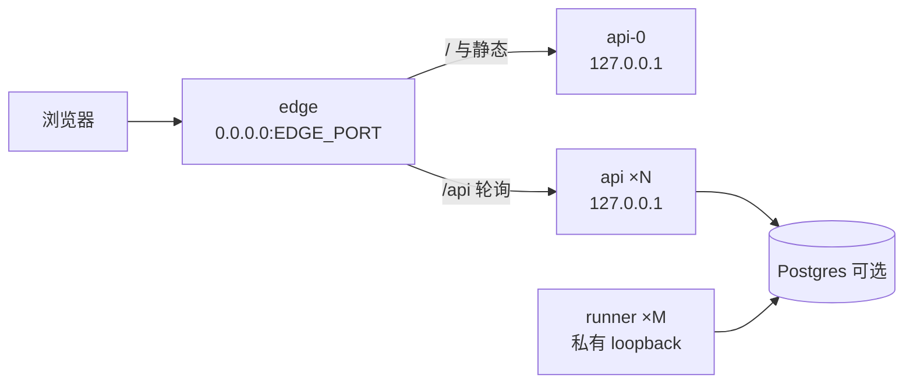
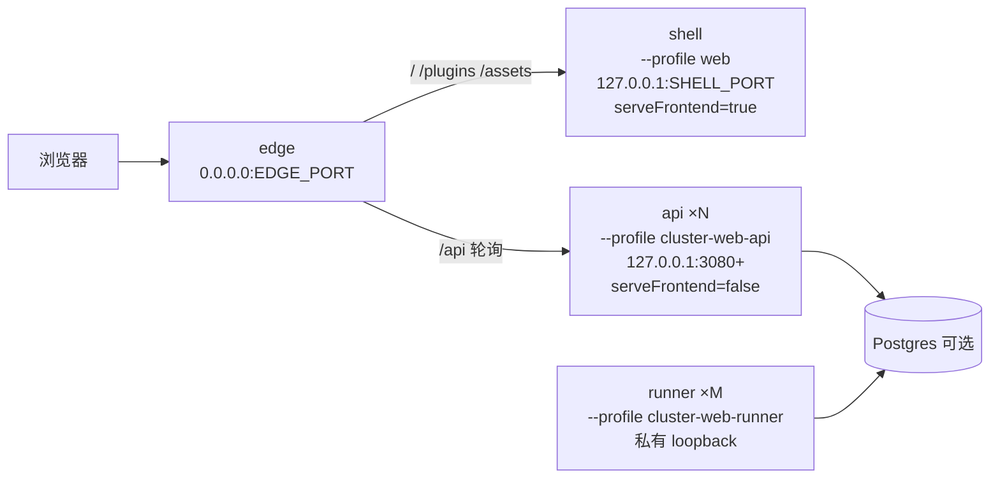
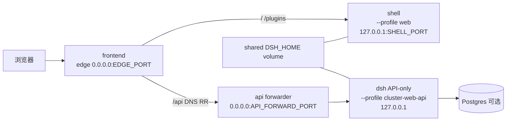

# delta — core-01-deployment-plan.md（变更 20261030-1651-cluster-web-independent-launch）

## MODIFIED — 二、部署拓扑（cluster-web 各节）

**cluster-web Compose 拓扑（cluster-web-compose 起，同域一键 · P0）**：

- 一键：`docker compose -f deploy/cluster-web/docker-compose.yml up --build`，或 `pnpm run cluster-web:up`（P1，根脚本包装 `deploy/cluster-web/supervise.mts`），或 `helm upgrade --install dsh deploy/cluster-web/chart`（P2）；无 Docker 时亦可直接跑 `deploy/cluster-web/supervise.mts`（见 `deploy/cluster-web/README.md`）。
- 各角色经具名 profile 启动：shell=`web`、API=`cluster-web-api`、runner=`cluster-web-runner`（组合见技术架构 §12.10）；deploy 树只做进程编排，不再渲染 overlay。
- 验收 CPU：smoke 默认 `API_REPLICAS=1`、`RUNNER_REPLICAS=0`；硬上限 2；串行；峰值 ≤ `cpuThresholdPercent`（SMOKE-core-20/21/22）。K8s smoke 默认只做清单/`helm template`，不强制 live multi-Pod apply。

**cluster-web 前后端同域分离（cluster-web-fe-split · S46）**：

- **Config**：`web-runtime.config.serveFrontend`（`web` profile 字面量 `true`）；`cluster-web-api` bundle 置 `false`；`--api-only` CLI 已移除（升级指南见 `docs/upgrade-guide/v0.2.1-alpha.1/`）。无 Postgres 时 API 副本附加调用时补丁 `overlays/no-postgres.patch.yml` 回落 JSONL。
- **Edge env**：`STATIC_UPSTREAM`（shell）、`API_UPSTREAMS`（逗号列表）；兼容文档说明旧 `UPSTREAMS` 迁移。
- **共享凭证**：shell 与全部 API 共用同一 `$DSH_HOME`，保证 `client-connection/browser-session` 签名一致。
- **外仓前端**：替换 shell 进程/镜像；浏览器 origin 仍为 edge 的 `PUBLIC_URL`；相对路径 `/api`；不做跨域。
- **Helm**：chart 对齐 shell 容器（或 Deployment）与 edge 双上游；默认低副本。
- **验收**：SMOKE-core-23（扩展 20/21 语义）；串行；CPU ≤ `cpuThresholdPercent`。
- **与 S47**：S46 描述同域逻辑分流；**Compose 物理双容器与 API 容器级副本见 S47**。`pnpm run cluster-web:up` 进程树仍可用于无 Docker 验收路径。

**cluster-web 前后端双容器（cluster-web-fe-be-containers · S47）**：

- **Compose 服务**：`frontend`（edge+shell）、`api`（scale N≤2，每实例 forwarder+API-only）、可选 `postgres`。
- **不再**以单一 `cluster` 服务承载 shell+API+edge 作为 Compose 一等路径（回滚可恢复该形态）。
- **环境变量**：`PUBLIC_URL` / `TRUSTED_HOST` / `EDGE_PORT`（宿主发布与容器监听同端口）/ `SHELL_PORT` / `API_FORWARD_PORT` / `API_REPLICAS`（或 compose scale）；`DATABASE_URL` 在 api 容器内指向 `postgres` 服务名。
- **Helm**：`frontend` Deployment（1，入口 `frontend.mts`）+ `api` Deployment（replicas，入口 `api.mts`）+ 共享 `DSH_HOME` PVC；`api.mts` 启动 `cluster-web-api` profile（Postgres 持久化来自 bundle），Ingress → frontend。
- **验收**：SMOKE-core-24；串行；CPU ≤ `cpuThresholdPercent`；断言 `docker compose ps` 可见 frontend 与 api 分离（scale=2 时 ≥2 个 api 容器）。
