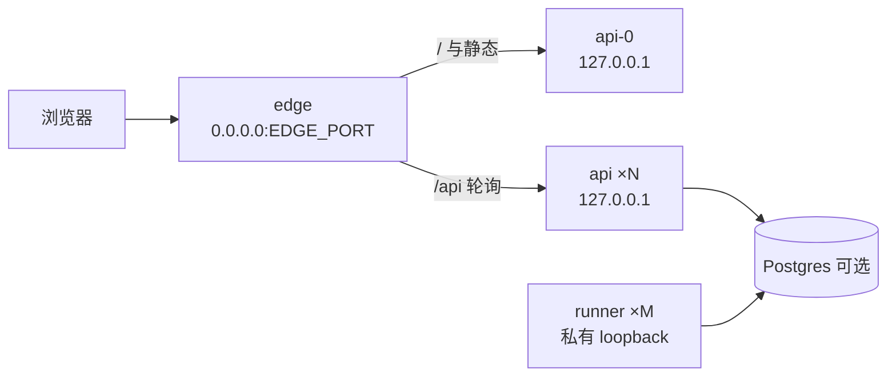

# delta — core-01-deployment-plan.md（变更 cluster-web-compose）

## ADDED — 二、部署拓扑 · cluster-web Compose（P0）

**cluster-web Compose 拓扑（cluster-web-compose 起，同域一键）**：

- 一键：`docker compose -f deploy/cluster-web/docker-compose.yml up --build`，或无 Docker 时 `node --import tsx/esm deploy/cluster-web/supervise.mts`。
- 验收 CPU：smoke 默认 `API_REPLICAS=1`、`RUNNER_REPLICAS=0`；硬上限 2；串行；峰值 ≤ `cpuThresholdPercent`。
- 交付目录：`deploy/cluster-web/`（compose、Dockerfile、env、overlays、edge、supervise、README）。

## MODIFIED — 三、环境变量与密钥（追加行）

| 项 | 来源 | 用途 |
|---|---|---|
| `PUBLIC_URL` / `TRUSTED_HOST` / `EDGE_PORT` | `deploy/cluster-web/.env` | 同域公告与 edge 监听 |
| `API_REPLICAS` / `RUNNER_REPLICAS` | 同上；smoke 默认 1/0；硬上限 2 | 进程树扇出；验收防打爆 CPU |
| `API_BASE_PORT` / `RUNNER_BASE_PORT` | 可选 | loopback 端口基址 |
| `CLUSTER_WEB_SKIP_OVERLAYS` / `CLUSTER_WEB_SKIP_RUNNERS` | smoke/本地 | 无库时跳过 overlay/runner |
| `CPU_THRESHOLD_PERCENT` | 与 fleet-staging 对齐 | 冒烟 CPU 天花板 |

## MODIFIED — 七、部署后检查清单（追加）

16. cluster-web（如部署）：edge 就绪；经 PUBLIC_URL 非 5xx；副本未超上限；CPU 峰值 ≤ 阈值（SMOKE-core-20）。
