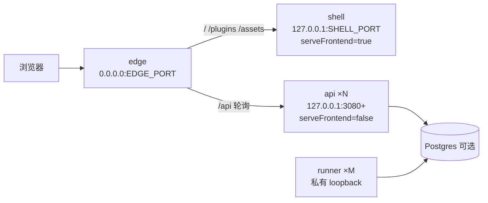

# delta — core-01-deployment-plan.md（变更 cluster-web-fe-split）

## MODIFIED — cluster-web Compose 拓扑（在既有 S43 段落后追加前后端分离）

在既有 **cluster-web Compose 拓扑（cluster-web-compose · P0）** 说明之后追加：

**cluster-web 前后端同域分离（cluster-web-fe-split · S46）**：

- **Config**：`web-runtime.config.serveFrontend`（默认 `true`）；API overlay 置 `false`；可选 CLI `--api-only`。
- **Edge env**：`STATIC_UPSTREAM`（shell）、`API_UPSTREAMS`（逗号列表）；兼容文档说明旧 `UPSTREAMS` 迁移。
- **共享凭证**：shell 与全部 API 共用同一 `$DSH_HOME`，保证 `client-connection/browser-session` 签名一致。
- **外仓前端**：替换 shell 进程/镜像；浏览器 origin 仍为 edge 的 `PUBLIC_URL`；相对路径 `/api`；不做跨域。
- **Helm**：chart 对齐 shell 容器（或 Deployment）与 edge 双上游；默认低副本。
- **验收**：SMOKE-core-23（扩展 20/21 语义）；串行；CPU ≤ `cpuThresholdPercent`。

## MODIFIED — 编排器无关原则中的「前端独立部署」句（明确落地）

保留原句「前端独立部署走同域反代（`/` → 静态 dist、API 前缀 → 后端副本）」，并注明：**本仓落地为 shell（Cordis + frontend-static，非裸 CDN dist）**；外仓替换须满足同域 + boot/token/`/plugins` 契约；跨域不在支持范围。
