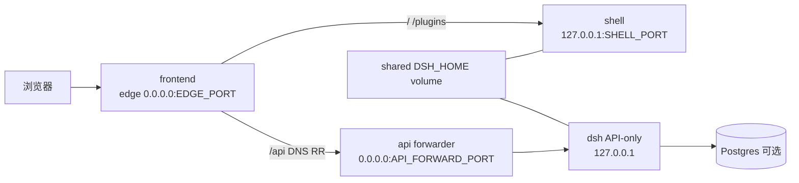

# delta — core-01-deployment-plan.md（变更 cluster-web-fe-be-containers）

## MODIFIED — cluster-web 前后端同域分离段落后追加双容器拓扑

在既有 **cluster-web 前后端同域分离（cluster-web-fe-split · S46）** 说明之后追加：

**cluster-web 前后端双容器（cluster-web-fe-be-containers · S47）**：

- **Compose 服务**：`frontend`（edge+shell）、`api`（scale N≤2，每实例 forwarder+API-only）、可选 `postgres`。
- **不再**以单一 `cluster` 服务承载 shell+API+edge 作为 Compose 一等路径（回滚可恢复该形态）。
- **环境变量**：`PUBLIC_URL` / `TRUSTED_HOST` / `EDGE_PORT` / `SHELL_PORT` / `API_FORWARD_PORT` / `API_REPLICAS`（或 compose scale）；`DATABASE_URL` 在 api 容器内指向 `postgres` 服务名。
- **Helm**：`frontend` Deployment（1，入口 `frontend.mts`）+ `api` Deployment（replicas，入口 `api.mts`）+ 共享 `DSH_HOME` PVC；`api.mts` 应用共享 Postgres overlay，Ingress → frontend。
- **验收**：SMOKE-core-24；串行；CPU ≤ `cpuThresholdPercent`；断言 `docker compose ps` 可见 frontend 与 api 分离（scale=2 时 ≥2 个 api 容器）。

## MODIFIED — S46 段补充与 S47 关系一句

在 S46 段「验收」句后注明：S46 描述同域逻辑分流；**Compose 物理双容器与 API 容器级副本见 S47**。裸机/`dsh up` 进程树仍可用于无 Docker 验收路径。
