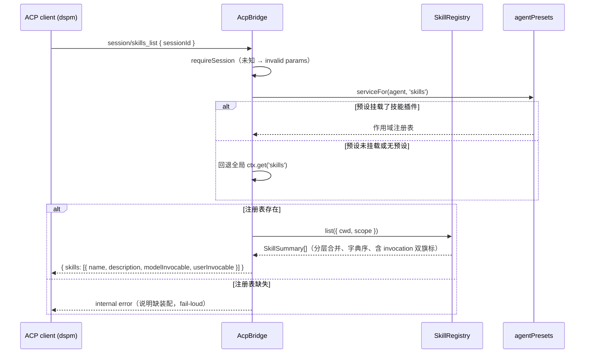

# delta — core-S50-acp-skills-list.md（变更 dsh-acp-skills-list）

## ADDED — core S50: 外部客户端枚举会话技能清单（场景实现）

# core S50: 外部客户端枚举会话技能清单（场景实现）

> 来源：变更 `dsh-acp-skills-list`。场景定义见 `core-01-requirements.md` §S50；交互规格见 `core-01-feature-design.md` §10。

## 1. 参与者

| 参与者 | 职责 |
|---|---|
| 外部 ACP 客户端（dspm） | 调用 `session/skills_list` 拉取清单，按双旗标区分 UI 入口 |
| `AcpBridge`（扩展方法注册） | 校验会话归属与参数，委托解析与映射，错误分类返回 |
| 技能注册表（`ctx.skills`） | 既有 invocation-neutral `list({cwd, scope})`：分层合并、同名覆盖、字典序 |
| 预设注册表（`ctx.agentPresets`） | 既有 `serviceFor(agent, 'skills')` 提供会话预设作用域注册表 |
| `SessionSkillCatalog` | 既有 dsh 自有 UI 通道，本变更不改动（保留 userInvocable 过滤） |

## 2. 解析链与字段

1. 会话解析：bridge 会话恒为 live agent（`requireSession` 拒绝未知会话）；`cwd` 取会话 header（`session/new` 已校验绝对路径）。
2. 注册表解析：`ctx.get('agentPresets')?.serviceFor(agent, 'skills')` 优先（预设挂载作用域注册表），缺失回退全局 `ctx.get('skills')`；两者皆缺 fail-loud（internal error 类，说明 neither preset mount nor host composition mounts @deepseek-ai/dsh-skill），与 `skill-catalog.ts:66-72` 姿态一致。
3. 枚举：以 `{ cwd, scope }` 调用 `list`，不做调用面过滤；全局层与作用域链按最近层同名覆盖合并，结果名字典序（注册表既有行为）。
4. 字段映射：`name` / `description` 直取；`modelInvocable` / `userInvocable` 取 `SkillSummary.invocation` 解析值；`path`、`whenToUse`、`source`、`provider` 不暴露。
5. 只读：不落会话事件、不进入模型 transcript、不在 bridge 缓存；每次调用经注册表 collect 缓存即时发现。

## 3. 主路径时序

## 4. 双旗标语义

- `modelInvocable=false`：手势专属技能（frontmatter `disable-model-invocation`）；不出现在模型目录与 `skill` 工具 schema，客户端 UI 不渲染「可被模型调用」入口。
- `userInvocable=false`：模型专属技能；不出现在人类命令目录，客户端 UI 不渲染手势触发入口。
- 服务端不过滤、不聚合：清单是 invocation-neutral 数据，过滤策略由各消费边界施加（dsh 自有 UI 通道过滤 userInvocable；ACP 客户端按旗标自行处理）。

## 5. 错误与边界

- 未知会话 id：invalid params 类错误（与既有 `requireSession` 一致）。
- 注册表缺失：internal error 类错误并说明缺装配；不返回空列表、不静默降级。
- 目录发现部分失败：沿用注册表既有语义（不完整观察不缓存、逐 provider 降级告警），方法如实返回当前可得清单。
- `skills/change` 实时推送不在本场景：客户端按需重拉；后续增量可镜像 topologyChanged → config_option_update 推送模式。
- 经 ACP 加载技能体不在本场景：调用仍只经 `skill` 工具与用户手势路径。

## 6. 验收条件映射

| AC | 覆盖测试 |
|---|---|
| S50-AC 清单枚举与双旗标 | UT-S50-01、UT-S50-03、ST-S50-01 |
| S50-AC 预设作用域解析与同名覆盖 | UT-S50-02 |
| S50-AC 未知会话与注册表缺失 fail-loud | UT-S50-01、UT-S50-04、ST-S50-01 |
| S50-AC 只读无副作用 | UT-S50-05 |
| S50-AC 真实组合与快照 | UT-S50-05、SMOKE-acp-network-04 |
| S03/S49 回归 | ST-S03-01、ST-S03-02、UT-S49-01、UT-S49-05、SMOKE-acp-network-01/02/03 |
