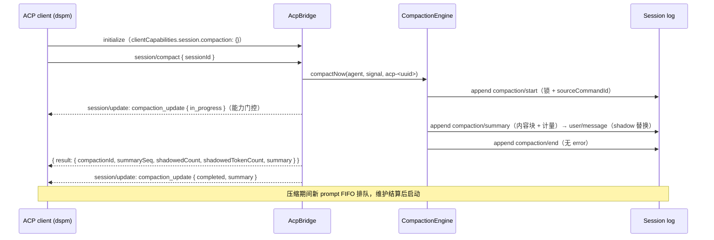

# delta — core-S52-acp-compaction.md（变更 dsh-acp-compaction）

## ADDED — core S52: 外部客户端触发会话压缩并感知压缩生命周期（场景实现）

# core S52: 外部客户端触发会话压缩并感知压缩生命周期（场景实现）

> 来源：变更 `dsh-acp-compaction`。场景定义见 `core-01-requirements.md` §S52；交互规格见 `core-01-feature-design.md` §12。

## 1. 参与者

| 参与者 | 职责 |
|---|---|
| 外部 ACP 客户端（dspm） | 调用 `session/compact` 触发显式压缩；声明 `session.compaction` 能力后消费 `compaction_update` 生命周期 |
| `AcpBridge`（扩展方法注册） | 归属与参数校验、自铸 CommandId、委托引擎、六码错误映射、initialize 捕获 clientCapabilities |
| `CompactionEngine` / compaction-basic | 既有压缩事务：空闲相位认领、持久锁、摘要、shadow 替换、自动触发——本变更不改动 |
| `AcpSession.onSessionEvent` | 既有事件派发通道上新增 capability 门控的 `compaction_update` 派生 |
| 既有压缩通道 | `/compact` 命令、自动触发策略、web 投影——本变更不改动 |

## 2. 方法面与字段

1. **注册与解析**：SDK 扩展方法 `session/compact`（原始方法名 + 参数解析器，与 `SKILLS_LIST_METHOD` 同模式）；参数恰为 `{ sessionId }`（非对象 / 缺空 sessionId → invalid params）。
2. **执行**：`AcpSession.compact()` 内 `assertActive()` 后读 `ctx.get('compaction')`，缺席抛 internal error（说明缺装配）；bridge 以 `CommandId('acp-' + randomUUID())` 自铸 sourceCommandId（opaque branded string，与 executor 铸造同形），调用 `compactNow(agent, requestSignal, sourceCommandId)`——agent 结构性满足 `ManualCompactAgentContext`（`session` / `options` / `runMaintenance`）。
3. **成功映射**：`CompactionResult` → `{ result: { compactionId, summarySeq, shadowedCount: shadowedSeqs.length, shadowedTokenCount, summary } }`；`null` → `{ result: null }`。
4. **错误映射**：`ManualCompactionError` 六码 → internal error `data: { code }`，message 复用 command-compact `expectedFailure` 的人类文本；请求 signal 已中止 → `cancelled`；其余异常（非预期）→ internal error 通用包装。
5. **通知派生**：`clientCapabilities?.session?.compaction` 在场时，`onSessionEvent` 新增分支：`compaction/start` → `{ compactionId, status: 'in_progress' }`；`compaction/end` 无 error → `completed` + summary（同 compactionId 前置 `compaction/summary` 事件的内容块，按事件顺序暂存关联）；`compaction/end` 带 error → `failed` + error 文本。经既有 `outputTail` 排序，与其它 update 同队列。

## 3. 主路径时序

## 4. 边界与错误传播

- **错误分支**：busy（压缩中竞态或非空闲）→ cancelled（caller 取消 / 会话收尾中断，signal 中止路径）→ changed / summary / commit / persistence（引擎既有分类）→ 服务缺席（fail-loud）；均不静默降级，失败尝试留痕日志。
- **通知不对称**：`cancelled` 仅在同步错误 data.code；日志 `compaction/end { error }` 不区分类别，bridge 不合成 cancelled 通知——诚实记录而非伪造分类。
- **UNSTABLE 隔离**：未声明能力的客户端零通知；dspm §6 答复只决定其客户端是否声明，dsh 实现与答复无关。
- **零持久化面变更**：复用 S15 既有事件与 shadow 协议；无 `SESSION_FORMAT_VERSION` 影响；模型可见 ⟺ 已记录不变（通知全部由持久事件派生）。
