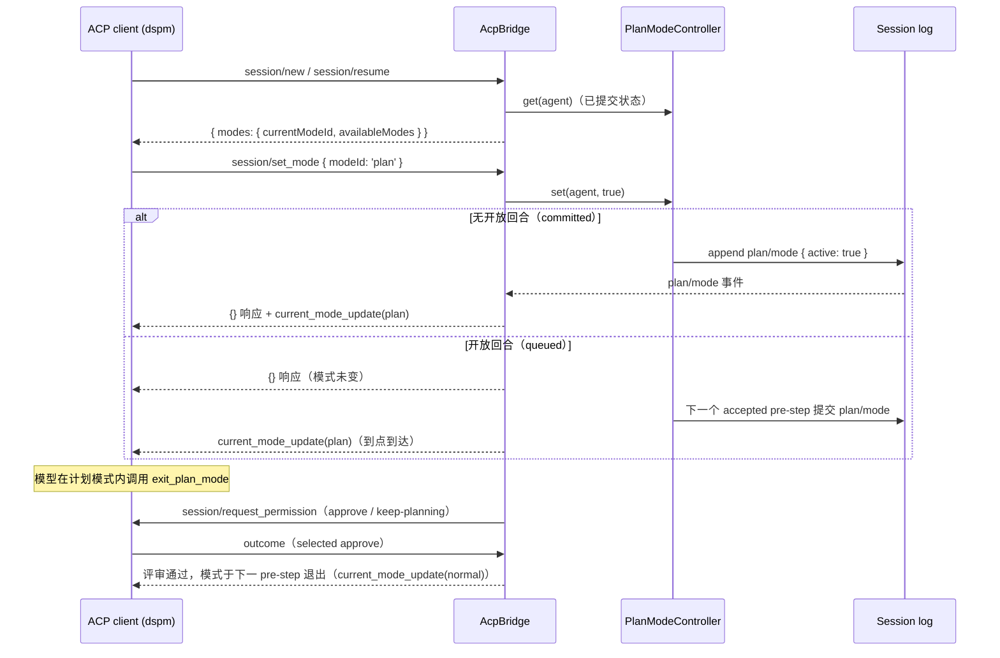

# core S51: 外部客户端经 ACP 感知与切换计划模式（场景实现）

> 来源：变更 `dsh-acp-plan-mode`。场景定义见 `core-01-requirements.md` §S51；交互规格见 `core-01-feature-design.md` §11。

## 1. 参与者

| 参与者 | 职责 |
|---|---|
| 外部 ACP 客户端（dspm） | 读取 `modes` 广告、调用 `session/set_mode`、消费 `current_mode_update`、应答 plan-review `session/request_permission` |
| `AcpBridge`（方法注册与评审应答者） | 词表与归属校验、委托 `PlanModeController.set`、new/resume 广告 `modes`、plan-review → request_permission 转换 |
| `PlanModeController` | 既有模式状态服务：`set` 四态、`plan/mode` 事件、`plan` 投影、排队与提交 |
| `AcpSession.onSessionEvent` | 既有事件派发通道上新增 `plan/mode` → `current_mode_update` 派生推送 |
| 既有计划模式通道 | `/plan` 命令、web 投影、`exit_plan_mode` 工具——本变更不改动 |

## 2. 方法面与字段

1. **modes 广告**：`AcpSession.modes()` 读 `ctx.get('planMode')`；插件缺席返回 undefined，bridge 省略 new/resume 响应的 `modes` 字段（ACP 可选字段语义）。在场时 `availableModes` 恒为 `plan` / `normal` 二值（含 name 与 description），`currentModeId` 取 `planMode.get(agent)` 的已提交状态（忽略 pending——排队意图不体现、不跨 runtime 生存）。
2. **set_mode 注册**：标准方法 `methods.agent.session.setMode`；handler 依次 `assertOpen` → `requireSession` → 词表校验（非 `plan`/`normal` 即 invalid params，消息含可接受词表）→ `record.setMode(modeId)`。`AcpSession.setMode` 内 `assertActive()` 后读 `ctx.get('planMode')`，缺席抛 internal error（fail-loud，说明缺装配）；调用 `controller.set(agent, modeId === 'plan')`，四态结果不进响应（响应恒 `{}`）。
3. **生效推送**：`onSessionEvent` 新增 `event.type === 'plan/mode'` 分支，经既有 `outputTail` 排序发 `{ sessionUpdate: 'current_mode_update', currentModeId: event.data.active ? 'plan' : 'normal' }`——由持久事件派生，与其它 update 同队列，bridge 不合成通知。
4. **评审转换**：bridge 在 `connect()` 上注册 `user-questions/request` 瀑布应答者（随连接释放，与审批瀑布同模式）：`request.agent` 非 bridge 自有 → `next()`；问题数 ≠ 1 或 intent 非 plan-review → `next()`；命中则 `drainUpdates()` 后发 `session/request_permission { sessionId, toolCall: { toolCallId: intent.callId }, options: [approve(allow_once), keep-planning(reject_once)] }`。outcome selected → 按 optionId 映射 `AskUserQuestionAnswer`（approve → `selected: ['Approve']`，其余 → `selected: ['Keep planning']`）；outcome cancelled 或连接已断 → `UserQuestionError('ASK_CANCELLED')`。

## 3. 主路径时序

## 4. 边界与错误传播

- **错误分支**：未知会话（invalid params）→ 未知 modeId（invalid params + 词表）→ 会话关闭中（invalid params）→ plan-mode 缺席（internal error + 说明缺装配）；与 `requireSession` / skills_list 既有姿态一致。
- **时序契约**：`set_mode` 响应不携带生效信息；客户端 UI 以 `current_mode_update` 为唯一生效事实；排队意图不跨 runtime 生存，resume 广告已提交状态。
- **评审收窄**：仅 plan-review intent 走 request_permission；`ask_user_question` 等其余问题保持 `NO_PROVIDER`（REQ-D6 范围）；非 bridge 自有会话的问题不受影响。
- **强制只读**：不在本场景；plan mode 不读 sandbox/审批状态，mode→preset 联动为条件性后续立项。
- **零持久化面变更**：复用 S11 既有事件与投影；无 `SESSION_FORMAT_VERSION` 影响；模型可见 ⟺ 已记录不变（narration 沿用控制器既有行为）。
