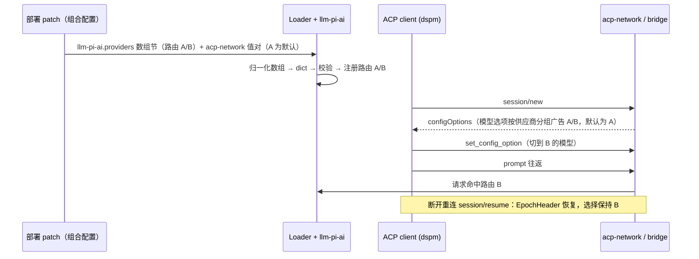

# core S53: 部署配置以数组形态供给多供应商路由（场景实现）

> 来源：变更 `dsh-acp-multi-provider`。场景定义见 `core-01-requirements.md` §S53；交互规格见 `core-01-feature-design.md` §13。

## 1. 参与者

| 参与者 | 职责 |
|---|---|
| 部署方（dspm） | 以数组（或 dict）形式在 profile patch 声明多供应商路由与默认路由值对 |
| llm-pi-ai | 配置 schema 双形式、归一化、档案校验、路由注册与可配置目录、凭据每请求解析 |
| llm 注册表 | 多路由注册面（`listProviders` 为 configOptions 的数据源） |
| acp-network / AcpBridge / model-control | 会话默认路由选择、configOptions 分组广告、`set_config_option` 切换——本变更不改动 |
| settings 文档 | dict-only 供给与活重配——本变更不改动 |

## 2. 配置面与归一化

1. **数组项形态**：`{ provider: string, ...PiAiProviderProfile }`；`provider` 非空且数组内唯一，作为归一化后的路由键。
2. **归一化点**：配置解析入口（schema 校验后、`resolveProfiles` 前）将数组折叠为 dict；此后管线零改动（档案校验、memoized 快照、`registerAdapter`、`registerConfigurableProviders`、`registerModelDiscovery`、凭据解析）。
3. **冲突矩阵**：双形式同供 / 重复路由键 / 缺失或空路由键 / 非法档案条目 → 加载期硬失败并指名路由与来源；数组形式 + settings 文档供给 → 运行时合并冲突，诊断错误 + 路由集保持上一有效集（既有冲突语义，不静默吞并）。
4. **守卫上下文**：dict 值的 `provider` 字段仍拒绝（迁移守卫不变）；数组项该字段即路由键。

## 3. 主路径时序

## 4. 边界与错误传播

- **冲突全部可指名**：自包含冲突（双形式、重复键、缺键、非法条目）加载期硬失败；数组+settings 合并冲突诊断失败并保持上一有效路由集；值对未注册路由会话创建 fail-loud——无任何静默降级路径。
- **settings 活重配的边界**：数组是组合层的静态声明形式，与 settings 供给互斥；运行时活重配语义由 dict 组合承载（web Models 页机制不变）。
- **协议面透明**：bridge 与 model-control 只消费 llm 注册表；本变更零新增会话事件、零新增 wire 类型，模型可见 ⟺ 已记录不变，无 `SESSION_FORMAT_VERSION` 影响。
