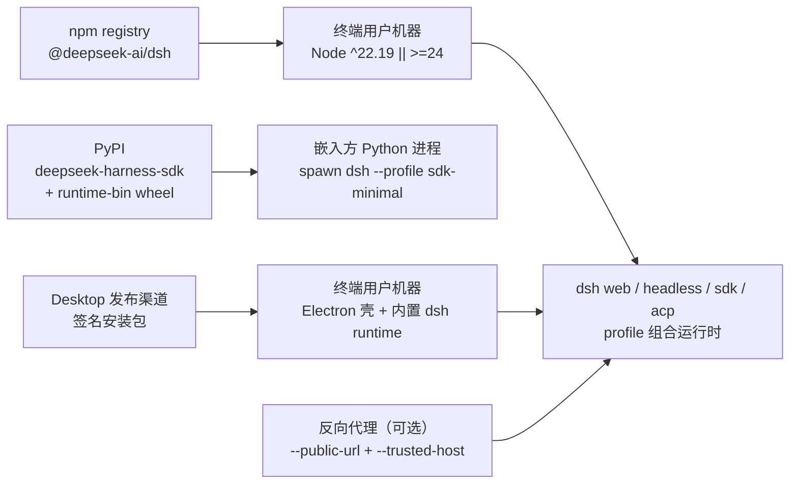
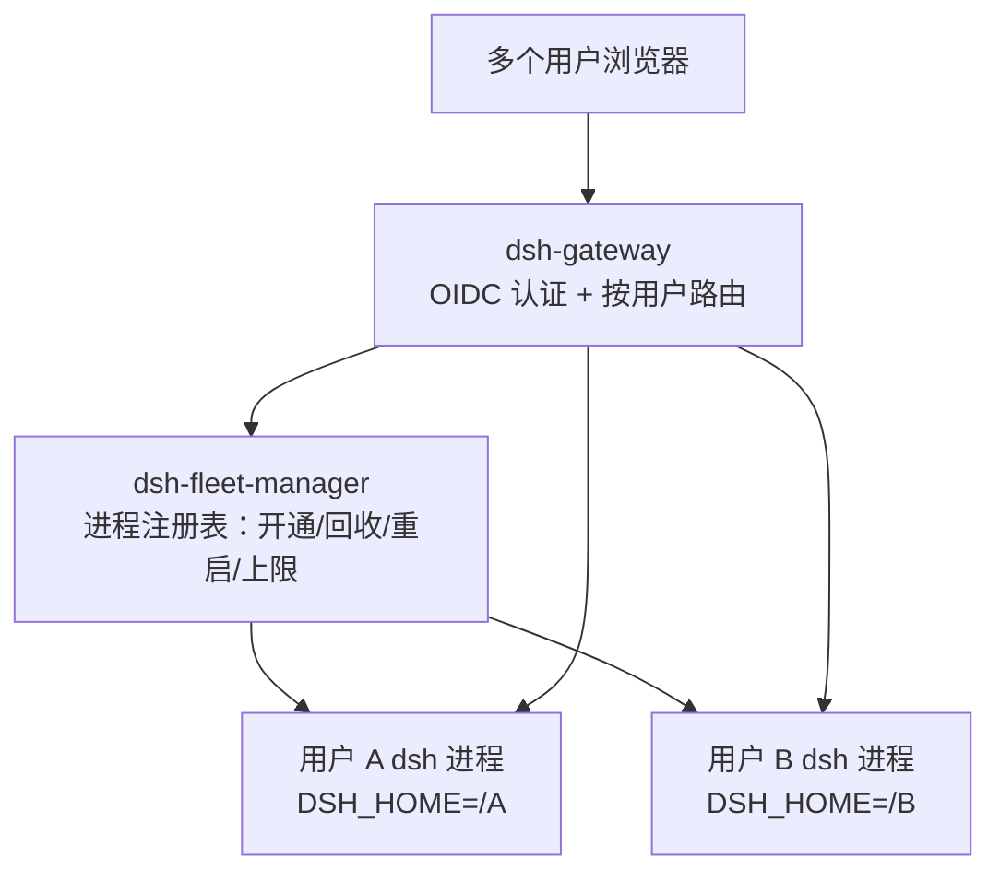
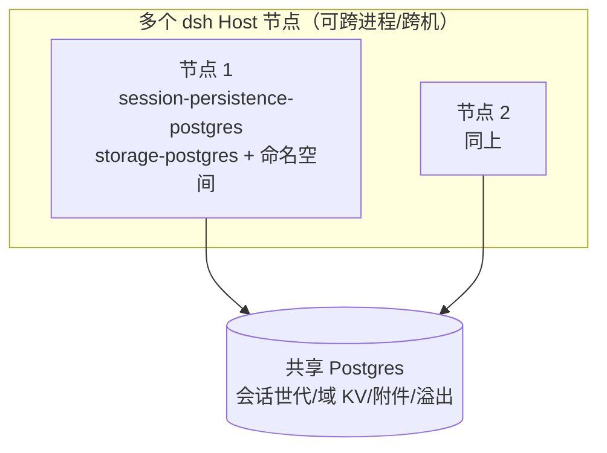
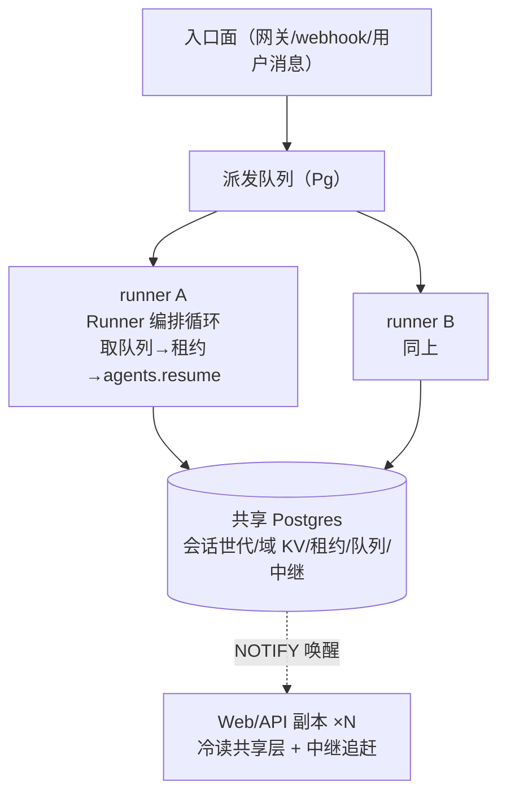
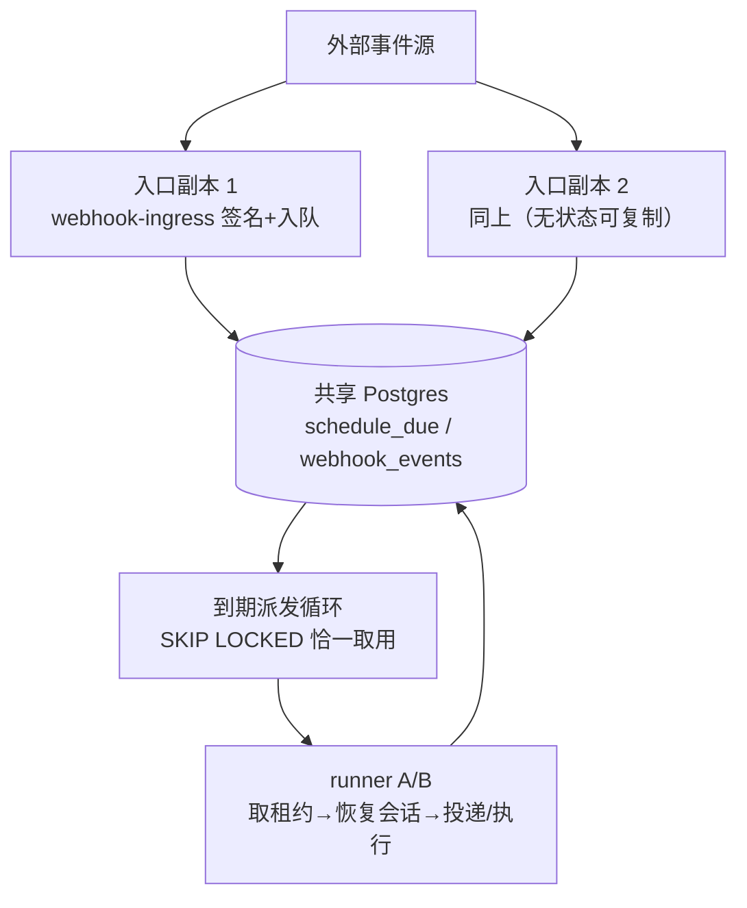
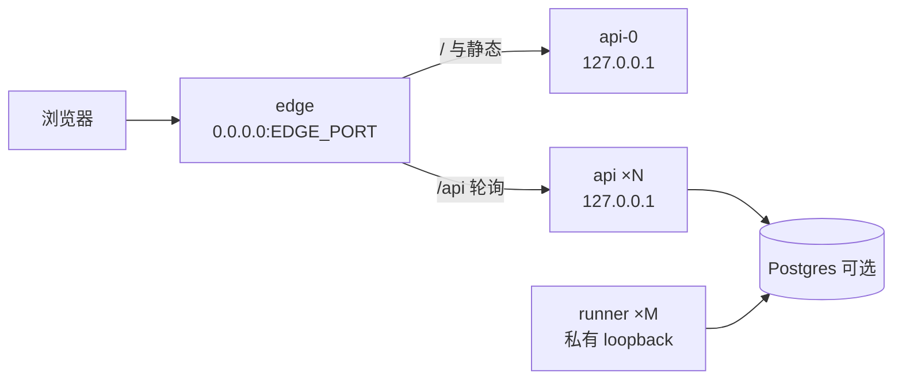
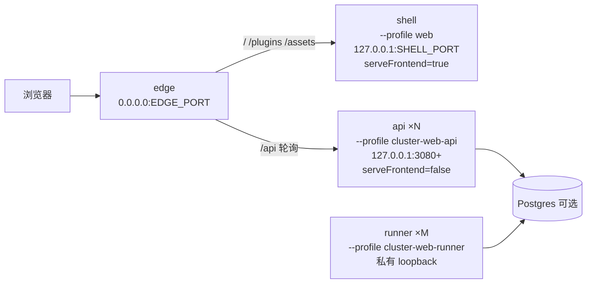
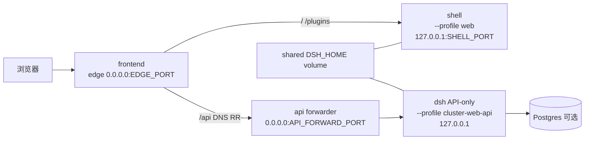

# core-01-deployment-plan

> 最后更新：2026-11-08
> 文档性质：存量项目逆向整理的部署基线，描述 0.2.1-alpha.1 已存在的分发/安装/发布路径与部署后检查项。本方案只设计不执行；部署执行与 smoke 属 Phase 3-7/3-8 人类确认点。

## 一、部署目标

dsh 是本地/自托管优先的 Node 应用集合，无托管服务端。「部署」在此等价于**把可运行产物交付到目标机器并验证可用**：

- npm 主包 `@deepseek-ai/dsh`（`apps/cli`，bin `dsh`）→ 终端用户经 `npx @deepseek-ai/dsh web` 运行。
- Web 前端 `apps/web`（vite dist）随 `dsh web` 伺服，不独立部署。
- Desktop 安装包（Electron，`apps/desktop`，签名与公证后发布）。
- Python SDK：`deepseek-harness-sdk` + 平台 runtime wheel（`deepseek-harness-runtime-bin`）→ PyPI。
- 插件生态：终端用户经 `dsh plugin` 向 profile 安装 npm 包。

## 二、部署拓扑

**fleet 形态拓扑（user-fleet-gateway 起，多用户自托管部署）**：

- fleet 是**新增部署形态**，与既有单用户拓扑并存：单用户路径（`dsh web` 直启、`--public-url` 反代）行为不变。
- fleet 组件为部署侧新组件（`dsh-gateway`、`dsh-fleet-manager`），每用户 dsh 进程仍由既有 profile 组合启动。

**共享持久层拓扑（shared-persistence-backends 起，fleet 可选扩展）**：

- 共享持久层是 fleet 的**可选并列后端**：未配置时全部数据仍在每用户 `$DSH_HOME` 本地（JSONL/SQLite/local 附件），行为不变；配置共享 Postgres 后，会话世代、域 KV、附件/溢出落在共享库，任一节点可打开同一用户历史会话。
- staging 验证用 `@embedded-postgres/linux-x64` 免 root 真实 Postgres 二进制起共享库；不需要 root 或系统服务。

事实来源：`README.md`（Run from npm）、`docs/architecture.md` §Application launch/§Desktop application、`python/sdk-runtime/pyproject.toml`；fleet 形态见变更 `user-fleet-gateway` 提案与系统地图 §9；共享持久层见系统地图 §10。

**执行池拓扑（agent-runner-pool 起，共享持久层之上的可选执行形态）**：

- 执行池是共享持久层之上的**可选并列执行形态**：未配置时执行仍在每用户本地 Host 进程（M1 现状），行为不变；配置后同一会话任意时刻至多一个活跃 runner（租约仲裁），runner 崩溃后其他节点在租约过期内接管续跑。
- runner/副本进程为库级 Runner 编排驱动（staging 先例同共享持久层 driver）；Redis pub/sub 中继与 PTY 远程化不做（5.3 清单）。

**Host 本地服务分布式形态（distributed-host-services 起，执行池之上的可选扩展）**：

- profile 镜像形态：固定层（`dsh-base` 等）在镜像内烘焙，用户层（`cordis.patch.yml`、安装插件）放共享存储只读挂载；进程以 `DSH_CONFIG_READONLY=1` 声明只读配置，HMR 据此 fail-closed 禁用。
- 滚动升级：部署编排向旧 runner 发排空指令（停取队列、停心跳、等 turn 边界），新版本 runner 接管后旧进程退出；发布前跑 `test:snapshot` 全量（既有 CI 门）。

**编排器无关原则（stateless-cluster-deployment 起）**：上述所有集群形态（共享持久层/执行池/Host 本地服务）的仲裁语义全部锚定共享 Postgres——编排器只负责「起进程 / 发 SIGTERM」。支持矩阵：K8s / docker compose / systemd / 裸机多进程为同等支持，不做编排器专属集成。SIGTERM 到达 = 一次优雅排空（停接新工作、等 in-flight turn 边界、exit 0）；前端独立部署走同域反代（`/` → 静态 dist、API 前缀 → 后端副本）或 `--public-url`/`--trusted-host` 既有路径。**本仓落地为 shell（Cordis + frontend-static，非裸 CDN dist）**；外仓替换须满足同域 + boot/token/`/plugins` 契约；跨域不在支持范围。

**cluster-web Compose 拓扑（cluster-web-compose 起，同域一键 · P0）**：

- 一键：`docker compose -f deploy/cluster-web/docker-compose.yml up --build`，或 `pnpm run cluster-web:up`（P1，根脚本包装 `deploy/cluster-web/supervise.mts`），或 `helm upgrade --install dsh deploy/cluster-web/chart`（P2）；无 Docker 时亦可直接跑 `deploy/cluster-web/supervise.mts`（见 `deploy/cluster-web/README.md`）。
- 各角色经具名 profile 启动：shell=`web`、API=`cluster-web-api`、runner=`cluster-web-runner`（组合见技术架构 §12.10）；deploy 树只做进程编排，不再渲染 overlay。
- 验收 CPU：smoke 默认 `API_REPLICAS=1`、`RUNNER_REPLICAS=0`；硬上限 2；串行；峰值 ≤ `cpuThresholdPercent`（SMOKE-core-20/21/22）。K8s smoke 默认只做清单/`helm template`，不强制 live multi-Pod apply。

**cluster-web 前后端同域分离（cluster-web-fe-split · S46）**：

- **Config**：`web-runtime.config.serveFrontend`（`web` profile 字面量 `true`）；`cluster-web-api` bundle 置 `false`；`--api-only` CLI 已移除（升级指南见 `docs/upgrade-guide/v0.2.1-alpha.1/`）。无 Postgres 时 API 副本附加调用时补丁 `overlays/no-postgres.patch.yml` 回落 JSONL。
- **Edge env**：`STATIC_UPSTREAM`（shell）、`API_UPSTREAMS`（逗号列表）；兼容文档说明旧 `UPSTREAMS` 迁移。
- **共享凭证**：shell 与全部 API 共用同一 `$DSH_HOME`，保证 `client-connection/browser-session` 签名一致。
- **外仓前端**：替换 shell 进程/镜像；浏览器 origin 仍为 edge 的 `PUBLIC_URL`；相对路径 `/api`；不做跨域。
- **Helm**：chart 对齐 shell 容器（或 Deployment）与 edge 双上游；默认低副本。
- **验收**：SMOKE-core-23（扩展 20/21 语义）；串行；CPU ≤ `cpuThresholdPercent`。
- **与 S47**：S46 描述同域逻辑分流；**Compose 物理双容器与 API 容器级副本见 S47**。`pnpm run cluster-web:up` 进程树仍可用于无 Docker 验收路径。

**cluster-web 前后端双容器（cluster-web-fe-be-containers · S47）**：

- **Compose 服务**：`frontend`（edge+shell）、`api`（scale N≤2，每实例 forwarder+API-only）、可选 `postgres`。
- **不再**以单一 `cluster` 服务承载 shell+API+edge 作为 Compose 一等路径（回滚可恢复该形态）。
- **环境变量**：`PUBLIC_URL` / `TRUSTED_HOST` / `EDGE_PORT`（宿主发布与容器监听同端口）/ `SHELL_PORT` / `API_FORWARD_PORT` / `API_REPLICAS`（或 compose scale）；`DATABASE_URL` 在 api 容器内指向 `postgres` 服务名。
- **Helm**：`frontend` Deployment（1，入口 `frontend.mts`）+ `api` Deployment（replicas，入口 `api.mts`）+ 共享 `DSH_HOME` PVC；`api.mts` 启动 `cluster-web-api` profile（Postgres 持久化来自 bundle），Ingress → frontend。
- **验收**：SMOKE-core-24；串行；CPU ≤ `cpuThresholdPercent`；断言 `docker compose ps` 可见 frontend 与 api 分离（scale=2 时 ≥2 个 api 容器）。

## 三、环境变量与密钥

| 项 | 来源 | 用途 |
|---|---|---|
| `DEEPSEEK_API_KEY` / `DEEPSEEK_BASE_URL` | 进程环境或根 `.env` | 真实模型调用（e2e/演示；无 key 自跳过） |
| 用户 API key | `$DSH_HOME/.credentials.yaml`（经 settings 引用） | 会话模型调用；设置中仅存凭证引用 |
| `DSH_GITHUB_WEBHOOK_SECRET` | 部署 overlay 配置 | `/github` webhook 签名校验 |
| `HTTPS_PROXY`/`NO_PROXY`/`NODE_EXTRA_CA_CERTS` | 进程环境 | 代理网络与企业 TLS 拦截（`docs/user/guide/network-proxy.md`） |
| Windows 打包/签名密钥 | 发布者本地（EV 签名，见 `apps/desktop/README.md`） | Desktop 安装包签名 |
| OIDC issuer / client id / client secret | fleet 部署配置 | 网关认证（外部 OIDC 提供方） |
| fleet 用户 home 根目录 | fleet 部署配置 | 每用户 `$DSH_HOME` 的分配根（如 `<data>/homes/<subject>`） |
| fleet 并发上限 / 空闲回收阈值 / CPU 阈值 | fleet 部署配置（Config 字段，非硬编码） | 资源控制主旋钮：限制同时存活的用户进程数；staging 验收取小上限 |
| 共享 Postgres 连接串 | 部署配置（cordis.yml 配置字段） | `session-persistence-postgres` / `storage-postgres` / `attachment-postgres` / `spill-postgres` 指向共享库；缺失时各缝走本地默认后端，行为不变 |
| `DSH_FLEET_USER_ID` | fleet 管理器注入用户进程环境（M1 既有） | storage-domain 提供方派生每用户命名空间；未注入时走默认命名空间（单机行为不变） |

密钥原则：仓库内永不提交凭证；设置与日志只存凭证引用（`packages/credentials/`）。OIDC client secret 属部署密钥，同样不入库；共享 Postgres 连接串如含口令亦属部署密钥，只进部署配置不入库。
| 执行池租约/队列/中继连接串 | 部署配置（cordis.yml 配置字段） | `session-lease-postgres` / `stream-relay-postgres` / `agent-dispatch` 指向共享库；缺失时执行池不启用，执行留在本地 Host 进程，行为不变 |
| runner 节点标识 | 部署配置（每 runner 唯一） | 租约持有者标识与属主路由信息面（`ownerOf`）；staging 取 `runner-a`/`runner-b` |
| 共享 schedule/webhook 连接串 | 部署配置（cordis.yml 配置字段） | `schedule-dispatch` / `webhook-ingress` 指向共享库；缺失时走单机形态（Host timer / 入口直建会话），行为不变 |
| `DSH_CONFIG_READONLY` | 部署编排注入（集群只读配置形态） | 值 `1` 时 HMR fail-closed 禁用；未注入时 HMR 按 profile 既有默认 |
| runner 排空指令 | 部署编排（进程信号/管理调用） | 滚动升级按会话粒度排空；staging 演练在 SMOKE-core-18 走通 |
| `DSH_CONFIG_READONLY` | `1` = 集群只读配置形态 | HMR fail-closed 禁用；单租户形态下不注入 `DSH_FLEET_USER_ID`，全集群默认命名空间 |
| 循环配置化启动 | cordis.yml 配置字段 | `agent-dispatch` 的 `nodeId`、`schedule-dispatch` 的 `loop: true`、`webhook-ingress` 的 `consumer: true` 在场即加载自动起对应循环；SIGTERM → drain 排空退出 |

## 四、构建与发布命令

| 步骤 | 命令 | 事实来源 |
|---|---|---|
| 安装依赖 | `pnpm install`（node ^22.19 \|\| >=24） | `AGENTS.md` |
| 全量构建 | `pnpm run build`（tsc → lib/types；tsdown → runtime bundle） | `AGENTS.md` |
| 本地源码启动 | `pnpm dsh web` / `pnpm run dev:web` / `make web\|desktop` | `AGENTS.md`、`README.md` |
| 单元/覆盖门禁 | `pnpm run test` / `test:coverage`（per-file 100%） | `AGENTS.md`、`docs/testing.md` |
| 发布序列 | release 提交 + 版本 tag（如 `release(dsh): 0.2.1-alpha.1`） | git log 中的 `release(dsh):` 提交序列 |
| Desktop 打包 | `apps/desktop` 构建脚本（签名/公证；Windows EV 签名必读 `apps/desktop/README.md`） | `apps/desktop/README.md` |
| Python wheel | hatchling 构建（`python/sdk`、`python/sdk-runtime`） | `python/*/pyproject.toml` |
| fleet 组件构建 | `dsh-gateway`、`dsh-fleet-manager` 随全量构建产出（`pnpm run build`） | 变更 `user-fleet-gateway`（[code] 阶段新增组件） |
| 共享持久层契约测试 | `pnpm run test`（新后端 spec；`@embedded-postgres/linux-x64` 二进制缺失时相关用例显式 skip） | 变更 `shared-persistence-backends`（[code] 阶段新增包与测试） |
| staging 共享库起停 | 嵌入式 Postgres 二进制初始化数据目录 + 启动/停止（staging 部署任务执行，命令落在部署脚本/记录） | 变更 `shared-persistence-backends`（[deploy] 阶段） |

## 五、数据迁移策略

- **会话日志格式**：`SESSION_FORMAT_VERSION` 代际制。只追加新版本命名的后继代际（`session.vN.jsonl[.zstd]`），不改写/删除已提交代际；打开时选择最高规范代际或经相邻迁移链（v0→v1→…→v4）解码一次。SQLite 存储用单调 `SCHEMA_VERSION`。事实来源：`docs/architecture.md` §Session log、AGENTS.md。
- **用户数据**：会话/设置在 `$DSH_HOME`；升级不迁移则保持旧代际可读。无外部数据库服务。
- **共享持久层（本次变更）**：新后端为**并列选项**，指向共享 Postgres 的新部署从空库开始（表结构由后端首次连接按 DDL 创建，unit 版本戳同 `version-mismatch` 语义）；既有 JSONL 世代文件与迁移链原样保留、不受影响。**不做** JSONL/SQLite → Postgres 的自动数据迁移（范围裁剪，见提案）；如需把既有用户迁到共享层，属后续部署变体，届时另行提案。

## 六、回滚策略

- npm/PyPI：发布不可撤回的版本号递增（pre-stable 阶段以 alpha/rc 标签渐进）；回滚 = 用户侧重装上一版本 + upgrade guide 说明破坏面（`.agents/skills/dsh-create-upgrade-guide` 记录每次外部可感知破坏变更）。
- Desktop：更新器下载新版本并经用户确认安装；回滚为重装旧安装包。
- 会话数据：格式代际只增不回退，旧版本进程无法读新代际（读打开会拒绝未来版本），因此「回滚」不伴随数据降级承诺。

## 七、部署后检查清单

1. `dsh --version` 输出预期版本。
2. `dsh --profile 
 --dump-config` 能打印组合树（不启动应用即验证组合层）。
3. `dsh web` 在目标机器就绪并打印 URL；浏览器可开。
4. 无 key 启动应出现凭证引导而非崩溃（fail-loud 于最早可解析点）。
5. Desktop 安装包签名校验通过、首次启动进入 API-key 页或工作区。
6. `python -c "import deepseek_harness"` + 最小 run 可用（嵌入方环境）。
7. fleet 形态（如部署）：网关就绪、OIDC 发现可达、fleet 管理器运行；测试用户登录可开通专属进程。
8. 资源约束生效：fleet 并发上限按部署配置拒绝超额开通；验收/冒烟执行期间主机 CPU 利用率不超过部署配置阈值（冒烟用例串行执行，不并行拉起超量用户进程）。
9. 共享持久层（如部署）：共享 Postgres 可达、新后端表结构已创建；两个 dsh Host 实例指向同库时，任一节点可打开同一用户的历史会话（SMOKE-core-12）。
10. 命名空间隔离（如部署）：两个不同 fleet 用户的进程共享同库时，域数据互不可见（SMOKE-core-13）。
11. 执行池（如部署）：共享 Postgres 可达、租约/队列/中继表已创建；两个 runner 进程指向同库时，同一会话的并发执行被租约排除；kill 正在执行的 runner 后其他节点在租约过期内接管并接续 inbox 未消费输入（SMOKE-core-14）。
12. 流中继（如部署）：runner 执行中，非属主副本从中继按游标追赶，双副本看到相同帧序（SMOKE-core-15）。
13. Host 本地服务分布式形态（如部署）：共享 schedule/webhook 表已创建；双 runner 下到期任务恰一交付；webhook 事件恰一建会话（SMOKE-core-16/17）。
14. 排空演练（如部署）：runner 排空后新工作流向其余 runner，in-flight 会话到 turn 边界收尾并被接管续跑；升级后旧会话可打开（SMOKE-core-18）。
15. profile 只读形态（如部署）：`DSH_CONFIG_READONLY=1` 进程启动时 HMR 未启用；用户层配置经共享只读挂载可读。

## 八、冒烟测试方案

smoke 输入（具体 `SMOKE-*` 用例见 `logos/resources/test/smoke/core-smoke-test-cases.md`）：

- **健康检查**：`dsh --version`、profile dump-config、Desktop 首启。
- **核心入口**：`dsh web` URL 可达、`dsh headless` 最小任务（有 key 环境）、SDK initialize。
- **静态资源**：`dsh web` 伺服前端 dist（index 与 bundle 200）。
- **配置与密钥**：无凭证 fail-loud 检查、`.env` 读取、`--public-url`/`--trusted-host` 组合校验。
- **关键链路**：单会话 prompt→工具调用→最终答案（staging 有 key 时）；审批流一次性授权。
- **日志与监控**：启动日志无阻断性错误；fatal 错误经 Desktop IPC 上报。
- **fleet 认证与隔离**：网关 OIDC 登录开通、双用户隔离抽查、生命周期与资源上限（SMOKE-core-09..11）。执行约束：冒烟串行执行，主机 CPU 利用率不超过部署配置阈值。
- **共享持久层**：双节点指向同一共享 Postgres 各自打开同一用户历史会话、每用户命名空间互不可见（SMOKE-core-12/13）。执行约束同上：两个实例串行操作，嵌入式 Postgres 与双实例同时运行时监控 CPU 不超阈值。

目标环境：staging（对应 CI/发布前验证机；`deployment_gates.core.environments: [staging]`）。
- **执行池**：kill 正在执行 turn 的 runner → 其他节点租约过期内接管接续；双副本连不同节点看同一会话流式实时（SMOKE-core-14/15）。执行约束同上：runner 操作串行触发，嵌入式 Postgres 与多进程同时运行时监控 CPU 不超阈值。
- **Host 本地服务**：双 runner 到期恰一交付、webhook 恰一建会话、排空后接管续跑与升级后旧会话可打开（SMOKE-core-16/17/18）。执行约束同上：runner 操作串行触发，多进程运行时监控 CPU 不超阈值。

## 九、门禁结论

- `deployment_required: true`、`smoke_required: true`、环境 `staging`（已在 `logos-project.yaml.deployment_gates.core` 登记，无需变更）。
- 部署执行（Phase 3-7）与 smoke（Phase 3-8）为**人类确认点**：须在 `openlogos verify` 通过且用户明确授权后进行；本仓库作为开源 harness，常规「部署」动作由发布流水线/用户本地完成，无集中式 staging 服务器。

## 十、DeepSeek 动态模型目录发布（S48）

### 发布物与前置检查

- 发布物为包含 `llm`、`llm-deepseek`、`llm-deepseek-api-key`、`acp` 及对应文档变更的新 dsh 版本或镜像，部署记录必须包含精确 commit；本地源码修改不构成 dspm 可消费交付。
- 构建前确认受影响单元、真实 Loader 组合、ACP 集成、keyless 快照和聚焦 coverage 通过；真实 API e2e 与部署后 smoke 分别记录，不得用 Mock 结果替代 AC-6。
- 发布包含 `docs/upgrade-guide/v0.2.1-alpha.1/deepseek-dynamic-model-discovery/` 中英文指南，说明默认目录改为网络发现、显式 `models` 人工覆盖、发现错误传播和 ACP 不再补回未列出当前模型。

### 配置与凭据

- 不新增 Secret 渠道。继续通过当前 `apiKeyEnv`、credentials 服务或既有进程环境解析 API key；`DEEPSEEK_BASE_URL` 只在既有可信 launch environment 路径生效，密钥不得写入 cordis.yml、日志、缓存键、部署报告或仓库。
- 未配置 `models` 的 API-key 路由升级后开始访问解析后端点的模型列表 URL。默认 `discoveryTimeoutMs=10000`、`discoveryCacheTtlMs=30000`；部署可按端点能力显式调整，TTL 0 只关闭完成结果复用。
- 不支持模型列表接口或必须离线运行的部署，应在升级前显式配置人工 `models`；`models: []` 表示明确空目录。动态发现失败不会自动读取该人工配置，配置来源必须清楚固定。
- 无数据库或 Session 格式迁移；既有 `provider/model` 字符串保持不变。

### staging 部署步骤

1. 记录上一版可回滚发布物与 commit，构建并标识新版本或镜像。
2. 在 staging 使用既有 Secret 与目标 `baseURL` 启动 dsh ACP/headless 组合，不启用 dspm 静态 `profile_patch` 模型清单作为替代实现。
3. 检查启动日志无密钥和阻断性错误；读取动态目录，确认只包含上游真实 ID，失败和成功空目录不被静态项伪装。
4. 执行 SMOKE-core-25：选择目录中的实际模型完成真实推理（`deepseek-v4-flash` 在目录时优先选择该精确 ID，缺席时如实记录缺席并改选实际模型），再验证另一个实际目录模型；第二模型权限失败须如实记录。
5. 写入部署报告与结果后才标记部署完成；若真实凭据、端点或模型权限不可用，不得把相应真实验收标为 PASS。

### 回滚与部署后检查

- 回滚到上一版 dsh 发布物并重启对应 profile，恢复上一版 provider/ACP 行为；不得通过 dspm 预写静态模型清单制造回滚成功假象。
- 回滚不迁移或删除会话数据。动态选择的模型 ID 已按既有字符串持久化；旧版能否继续推理取决于其配置与上游支持，部署报告须记录该兼容性事实。
- 部署后检查动态目录新增/移除在 TTL 后可见、失败可重试、ACP 不补回失效模型、最终请求使用精确 ID，并保留 SMOKE-core-06 与 ACP 网络既有冒烟回归。

## 十一、ACP 审批策略配置发布（S49）

### 发布物与前置检查

- 发布物为包含 `acp`、`interaction/user-approval`、`interaction/permission-presets`、`core/tools` 及对应文档变更的新 dsh 版本或镜像，部署记录必须包含精确 commit；本地源码修改不构成 dspm 可消费交付。
- 构建前确认受影响单元、真实 Loader 组合、ACP 集成、keyless 快照和聚焦 coverage 通过；部署后 smoke 与真实 API e2e 分别记录。
- 发布包含 `docs/upgrade-guide/<发布版本>/acp-permission-policy/` 中英文指南，说明新增 option id、`always` 词表值、一次性选项语义保持与 fail-closed 行为。
- `approval/policy` 事件携带新值 `always` 的读兼容性（required-on-read 语义）在实现期评估；评估结论与所选机制记录在实现清单，不依赖日志向前兼容完成回滚。

### 配置

- 不新增 Secret、环境变量或 profile 配置项；审批策略是会话级状态，由客户端按会话设置，部署侧无需预置。
- 未设置策略的会话保持默认 `ask` 放行语义，升级前后行为一致；部署不为任何会话预置 `always`/`never`。
- 无数据库或 Session 格式迁移；策略与预设沿用既有 `approval/policy` 会话事件持久化。

### staging 部署步骤

1. 记录上一版可回滚发布物与 commit，构建并标识新版本或镜像。
2. staging 启动含 acp-network profile 的 dsh 实例，既有 Secret 与 token 签发流程不变。
3. 执行 SMOKE-acp-network-03：会话设置 `permission_policy=always` 后发起工具调用，验证 `session/request_permission` 往返与 allow-once 执行；对另一次调用 reject-once 验证拒绝分支；回归 `permission_preset` 预设应用。
4. 检查未知策略值返回 invalid params、状态不变；未配置策略的既有会话默认行为不变。
5. 写入部署报告与结果后才标记部署完成；审批往返不可复现时不得把 S49 验收标为 PASS。

### 回滚与部署后检查

- 回滚到上一版 dsh 发布物并重启对应 profile；回滚不迁移或删除会话数据，既有审批/预设会话事件按旧版语义读取（旧版不识别 `always` 值的行为已在实现期评估并记录）。
- 部署后检查：configOptions 广告含新 option id、`always` 往返 5s 内完成、fail-closed 分支可复现、SMOKE-acp-network-01/02 既有回归保持。

## 十二、ACP 技能清单入口发布（S50）

### 发布物与前置检查

- 发布物为包含 `acp`、`skill`、`preset/agent-preset-registry` 及对应文档变更的新 dsh 版本或镜像，部署记录必须包含精确 commit；本地源码修改不构成 dspm 可消费交付。
- 构建前确认受影响单元、真实 Loader 组合、ACP 集成、keyless 快照和聚焦 coverage 通过；部署后 smoke 与真实 API e2e 分别记录。
- 发布包含 `docs/upgrade-guide/<发布版本>/acp-skills-list/` 中英文指南，说明新扩展方法、字段语义（双旗标、不过滤）、fail-loud 行为与扩展方法属性。

### 配置

- 不新增 Secret、环境变量或 profile 配置项；`acp` 与 `acp-network` profile 经 `dsh-base` 已挂载 `@deepseek-ai/dsh-skill` 与 `@deepseek-ai/dsh-skill-filesystem`，部署无需新增装配。
- 自定义 profile 若剥离技能插件，`session/skills_list` 返回 internal error（fail-loud）——这是文档化行为，不是部署缺陷。

### staging 部署步骤

1. 记录上一版可回滚发布物与 commit，构建并标识新版本或镜像。
2. staging 启动含 acp-network profile 的 dsh 实例，既有 Secret 与 token 签发流程不变。
3. 执行 SMOKE-acp-network-04：会话创建后调用 `session/skills_list`，验证响应结构（数组、字典序、四字段）与部署环境已知技能目录一致；对未知会话 id 验证 invalid params 分支。
4. 检查既有 `skills/list` Typert Remote、prompt/resume 与 S49 审批策略路径回归保持。

### 回滚与部署后检查

- 回滚到上一版 dsh 发布物并重启对应 profile；本变更只读、无会话数据与配置变更，回滚无迁移。
- 部署后检查：`skills_list` 响应 ≤2s、结构合法、未知会话错误分支生效、SMOKE-acp-network-01/02/03 既有回归保持。

## 十三、ACP 计划模式入口发布（S51）

### 发布物与前置检查

- 发布物为包含 `acp` 模式面与评审应答者变更及对应文档的新 dsh 版本或镜像，部署记录必须包含精确 commit；本地源码修改不构成 dspm 可消费交付。
- 构建前确认受影响单元、真实 Loader 组合、ACP 集成、keyless 快照和聚焦 coverage 通过；部署后 smoke 与真实 API e2e 分别记录。
- 发布包含 `docs/upgrade-guide/<发布版本>/acp-plan-mode/` 中英文指南，说明标准方法语义、modes 词表、queued 时序契约（响应不承诺生效、以 current_mode_update 为准）、plan-review optionId 词表与插件缺席 fail-loud 行为。

### 配置

- 不新增 Secret、环境变量或 profile 配置项；`acp` / `acp-network` profile 经 `dsh-base` 已挂载 `@deepseek-ai/dsh-plan-mode`，部署无需新增装配。
- 自定义 profile 若剥离 plan-mode 插件，`session/set_mode` 返回 internal error 且 new/resume 省略 `modes`（fail-loud）——这是文档化行为，不是部署缺陷。

### staging 部署步骤

1. 记录上一版可回滚发布物与 commit，构建并标识新版本或镜像。
2. staging 启动含 acp-network profile 的 dsh 实例，既有 Secret 与 token 签发流程不变。
3. 执行 SMOKE-acp-network-05：new/resume 响应 `modes` 广告核对、`set_mode` plan/normal 往返与 `current_mode_update` 时序、重复设置无冗余更新、未知 modeId 错误分支、resume 恢复已提交模式。
4. 检查既有 prompt/resume、S49 审批策略、S50 技能枚举与 `/plan` 命令（自有 UI 通道）回归保持。

### 回滚与部署后检查

- 回滚到上一版 dsh 发布物并重启对应 profile；本变更零新增持久化数据（复用 S11 既有 `plan/mode` 事件），回滚无迁移。
- 回滚后旧构建不认识 `session/set_mode`（客户端得 -32601）、`modes` 字段不再出现（客户端按可选字段容忍）；计划模式下经 ACP 的 `exit_plan_mode` 评审回到无应答者行为（升级指南已按既有缺陷如实说明）。
- 部署后检查：`modes` 广告结构合法、set_mode 往返 ≤2s、`current_mode_update` 到达、未知 modeId 错误分支生效、SMOKE-acp-network-01..04 既有回归保持。

## 十四、ACP 会话压缩入口发布（S52）

### 发布物与前置检查

- 发布物为包含 `acp` 压缩方法与通知派发变更及对应文档的新 dsh 版本或镜像，部署记录必须包含精确 commit；本地源码修改不构成 dspm 可消费交付。
- 构建前确认受影响单元、真实 Loader 组合、ACP 集成、keyless 快照和聚焦 coverage 通过；部署后 smoke 与真实 API e2e 分别记录。
- 发布包含 `docs/upgrade-guide/<发布版本>/acp-compaction/` 中英文指南，说明扩展方法属性、六失败码 data.code 词表、capability 门控通知与 UNSTABLE 属性、压缩服务缺席 fail-loud 行为。

### 配置

- 不新增 Secret、环境变量或 profile 配置项；`acp` / `acp-network` profile 经 `dsh-base` 已挂载 `@deepseek-ai/dsh-compaction-basic` 与 `@deepseek-ai/dsh-command-compact`，部署无需新增装配。
- 自定义 profile 若剥离压缩插件，`session/compact` 返回 internal error（fail-loud）——这是文档化行为，不是部署缺陷。

### staging 部署步骤

1. 记录上一版可回滚发布物与 commit，构建并标识新版本或镜像。
2. staging 启动含 acp-network profile 的 dsh 实例，既有 Secret 与 token 签发流程不变。
3. 执行 SMOKE-acp-network-06：真实模型产历史后压缩往返、`{ result: null }` 分支、busy 竞态、未知会话错误、能力声明客户端的 `compaction_update` 核对与未声明客户端零通知。
4. 检查既有 prompt/resume、S49/S50/S51 路径与 `/compact` 命令（自有 UI 通道）回归保持。

### 回滚与部署后检查

- 回滚到上一版 dsh 发布物并重启对应 profile；本变更零新增持久化数据（复用 S15 既有 `compaction/*` 事件），回滚无迁移；已压缩会话的日志格式不变，旧构建可正常打开。
- 回滚后旧构建不认识 `session/compact`（客户端得 -32601）；声明能力的客户端不再收到 `compaction_update`（客户端按通知缺席容忍）。
- 部署后检查：压缩往返 ≤ 部署基线（真实模型耗时为主）、响应结构合法、busy 竞态分支生效、通知门控正确（声明者有、未声明者无）、SMOKE-acp-network-01..05 既有回归保持。

## 十五、多供应商路由供给发布（S53）

### 发布物与前置检查

- 发布物为包含 llm-pi-ai 配置双键形态与归一化及对应文档的新 dsh 版本或镜像，部署记录必须包含精确 commit；本地源码修改不构成 dspm 可消费交付。
- 构建前确认单元、真实 Loader 组合、配置面冲突矩阵与聚焦 coverage 通过；部署后 smoke 与回归分别记录。
- config-catalog 重生成随发布交付（配置 schema 变化）。
- 发布包含 `docs/upgrade-guide/<发布版本>/acp-multi-provider/` 中英文指南：`providers`/`providerList` 双键定义、settings dict-only、冲突 fail-loud 词表、dict-vs-数组选型说明、dspm 组合示例。

### 配置

- 不新增 Secret 或环境变量；新增组合配置键（`llm-pi-ai.providerList` 数组，组合专用、settings 不可写）。apiKeyEnv 引用的凭据经既有凭据解析（凭据存储或环境，键不入配置）。
- acp-network 的 `provider` / `model` 值对不变；默认路由须指向已注册路由，否则会话创建 fail-loud（既有行为）。

### staging 部署步骤

1. 记录上一版可回滚发布物与 commit，构建并标识新版本或镜像。
2. staging 启动含 acp-network profile 的 dsh 实例；若组合供给 llm-pi-ai 数组节，执行 SMOKE-acp-network-07（默认 staging 组合无数组供给时按 skip 语义记录，永不报 PASS）。
3. 冲突矩阵验证（`providers` 与 `providerList` 同供、重复路由键、缺路由键、非法条目）以独立启动进程记录加载失败诊断；数组+settings 合并冲突验证诊断与路由集保持语义。
4. 回归 SMOKE-acp-network-01..06 与 S03/S49/S50/S51/S52 面。

### 回滚与部署后检查

- 回滚到上一版 dsh 发布物并重启对应 profile；本变更零新增持久化数据，回滚无迁移。
- **回滚须同时还原组合 patch 中的 llm-pi-ai 数组节**：旧构建的配置 schema 拒绝数组形式，带着数组节回滚会在加载期失败；该注意项写入升级指南。
- 回滚后数组组合不可用，dict 组合与单路由部署不受影响；已注册路由行为与回滚前一致。
- 部署后检查：数组组合路由注册与 configOptions 分组广告、跨供应商切换命中与 resume 持久、冲突诊断指名、SMOKE-acp-network-01..06 既有回归保持。

## 十六、goal 授权经 ACP 发布（S54）

### 发布物与前置检查

- 发布物为包含 tool-goal 授权征求、goal-review 意图与 ACP 桥接应答者的新 dsh 版本或镜像，部署记录必须包含精确 commit；本地源码修改不构成 dspm 可消费交付。
- 构建前确认单元（ask/steer/deny/无通道/既有授权路径回归）、真实 Loader 组合 ST、快照（steer 消息与工具结果文本）与聚焦 coverage 通过；部署后 smoke 与回归分别记录。
- 零新增 Config（无 config-catalog 变更）；发布包含 `docs/upgrade-guide/<发布版本>/acp-goal-approval/` 中英文指南：ask 行为变化（有通道时会征求）、goal-review 意图、Deny/取消语义、无通道行为不变、goal-review 意图为宿主内呈现类型（双 SDK 零改动）。

### 配置

- 不新增 Secret、环境变量或组合配置键；goal 工具的征求行为由 userQuestions 通道存在性决定（`ctx.get('userQuestions')`），无部署侧开关。
- ACP 客户端无需 capability 声明：goal 授权卡经既有 `session/request_permission` 到达，客户端按普通权限卡片处理即可；识别 `goal-review` 意图的客户端可做呈现优化（协议不依赖）。

### staging 部署步骤

1. 记录上一版可回滚发布物与 commit，构建并标识新版本或镜像。
2. staging ACP 会话内驱动一次未授权 goal 完成：mock/真实模型触发 `complete` 调用 → 客户端收 `session/request_permission`（Authorize/Deny 词汇）→ 应答 Authorize → 会话日志核对注入的源 user 用户消息与完成事件（SMOKE-acp-network-08；staging 无交互握手时按 skip 语义记录，永不报 PASS）。
3. 验证 Deny 与取消路径（无注入、既有拒绝注明拒绝）、无通道 fail-fast（headless 组合）、admitted round 与 direct-human 路径不征求。
4. 回归 SMOKE-acp-network-01..07 与 S49（审批策略）、S51（plan-review）、S03（ACP 主链路）面。

### 回滚与部署后检查

- 回滚到上一版 dsh 发布物并重启对应 profile；零新增持久化事件类型，回滚无迁移；注入的授权消息是普通 `user/message`，旧构建读取无损。
- 旧构建无 ask 行为：未授权完成回到立即 `GOAL_TOOL_AUTHORITY_REQUIRED`；进行中的征求随旧进程终止，无残留状态。
- 部署后检查：授权卡往返全链路（SMOKE-acp-network-08）、Deny/取消路径、无通道 fail-fast、plan-review 意图应答不受影响、SMOKE-acp-network-01..07 既有回归保持。
